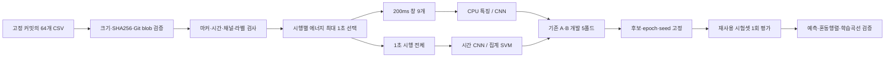

# Step2 — sEMG 손동작·팔꿈치 각도 분류

5채널 표면 근전도(sEMG)로 손동작 4종과 팔꿈치 각도 2종을 함께 분류한다. 사용자 PC의 **TITAN Xp 12GB**에서 원파형·시간별 주파수 CNN을 검증하고 기존 CPU 실험과 비교했다.

**A의 미관측 기록 평가에서 1초 CNN 시행 정확도는 50.51%**, 기존 XGBoost 시행 다수결은 25.90%였다. **B의 관측 기록 후속 시행 평가에서 200ms CNN은 창 82.00%, 시행 다수결 97.14%**였다. A와 B는 서로 다른 평가다. B의 97.14%를 A의 성능이나 논문 재현 성과로 해석할 수 없다.

이 저장소는 Step2 과제의 코드·설정·실험 결과를 정리한 공개 보고서다. 목적부터 결과 해석과 재현 방법까지 이 README 본문에서 확인할 수 있다. 원자료와 학습 모델은 사용자 PC에 별도로 보존했다.

## 1. 과제와 데이터

| 항목 | 내용 |
|---|---|
| 대상 | 익명 참가자 a–h, 총 8명 |
| 기록 | 사람별 8개 조건, 총 64개 CSV |
| 반복 | 기록당 30개 시행, 총 1,920개 시행 |
| 입력 | 이미 필터링된 5채널 신호, 1,000Hz |
| 동작 | fist, open, pro, extor |
| 각도 | 30°, 60° |
| 클래스 | 동작×각도, 총 8개 |
| 원자료 | [공개 저장소](https://github.com/TestUser-alt-dev/sEMG-Hand-Gesture-Elbow-Angle-Dataset) |
| 고정 커밋 | `cb64ded658b83ae97e6388dd373efad0e97bc47c` |
| 관련 논문 | [Lee 등, 2026, Biomedical Engineering Letters](https://link.springer.com/article/10.1007/s13534-026-00607-7) |

| 클래스 ID | 손동작 | 팔꿈치 각도 |
|---:|---|---:|
| 0 | 주먹쥐기(fist) | 30° |
| 1 | 주먹쥐기(fist) | 60° |
| 2 | 손펴기(open) | 30° |
| 3 | 손펴기(open) | 60° |
| 4 | 회내(pro) | 30° |
| 5 | 회내(pro) | 60° |
| 6 | 회외(extor) | 30° |
| 7 | 회외(extor) | 60° |

데이터 README에 따르면 채널 1–5는 각각 요측수근신근, 총지신근, 천지굴근, 상완이두근, 상완삼두근에 대응한다. 파일명·마커·라벨 매핑을 검사했지만 실제 전극 부착과 생리적 동작 정답을 독립적으로 검증한 것은 아니다. 원 제공자의 [README](https://github.com/TestUser-alt-dev/sEMG-Hand-Gesture-Elbow-Angle-Dataset/blob/cb64ded658b83ae97e6388dd373efad0e97bc47c/README.md)를 출처로 삼았으며 [파일별 해시 manifest](reference/corrected_v3/preprocessing/manifest.json)를 보존했다.

원논문 공개 초록은 RF의 5폴드 평균 정확도 96.72±0.58%를 보고한다. 전문의 분할·전처리·모델 세부 조건은 구독 제한으로 확인하지 못했다. 따라서 아래 결과와 논문 수치를 직접 비교하거나 정확한 재현이라고 주장하지 않는다.

## 2. 처리 흐름



원신호는 이미 60Hz notch와 20–450Hz bandpass 처리를 거쳤다고 명시돼 있다. 이번 신경망 실험은 추가 재필터링을 하지 않는다.

원 README의 명목상 시행은 휴식 2초·동작 1초·휴식 2초다. 그러나 마커가 어느 시점에 대응하는지는 확인되지 않았다. A의 개발 시행 1,530개 중 1,279개(83.59%)는 마커 뒤 1–2초에 합산 에너지가 가장 컸다. 따라서 기존의 **라벨 없는 에너지 정렬**을 유지했다.

1. 각 시행 경계를 현재 마커부터 다음 마커 직전까지로 정한다.
2. 0.5–3.5초 범위에서 0.1초 간격으로 1초 후보를 만든다.
3. 5채널 제곱합 에너지가 가장 큰 후보를 고른다. 동점은 앞선 후보를 선택한다.
4. 그 1초에서 200샘플 창을 100샘플씩 이동해 9개 창을 만들거나, 1초 전체를 사용한다.

에너지 정렬에는 라벨·다른 시행의 통계·시험 점수가 들어가지 않는다. 다만 약 5초 시행 전체와 경계가 필요하므로 200ms 온라인 지연 모델이 아니다. 큰 채널이나 잡음에 좌우될 수 있다. A 개발 시행의 3.92%는 한 채널이 선택 구간 에너지의 80%를 넘었다.

64개 원자료의 해시를 확인했고, 기존 특징의 앞 25열을 다시 계산한 최대 절대 오차는 **0.0**이었다. 기존 창 시작점·정답과도 모두 일치했다. 자세한 결과는 [데이터 검사](reports/data/audit.json)에 있다.

## 3. 누출 방지와 평가 범위

| 구분 | A: 미관측 기록 | B: 관측 기록의 후속 시행 |
|---|---|---|
| 개발/시험 | 기존 51/13개 기록 | 각 기록의 1–24/25–30번째 시행 |
| 개발/시험 시행 수 | 1,530/390 | 1,536/384 |
| 개발/시험 200ms 창 수 | 13,770/3,510 | 13,824/3,456 |
| 검증 | 개발 기록을 클래스별 5폴드 | 첫 24시행을 연속 5블록으로 분리 |
| 같은 기록이 양쪽에 존재 | 없음 | 있음 |
| 새로운 사람 평가 | 아님 | 아님 |

기존 `split.npz`를 그대로 사용했다. 같은 시행의 겹치는 창은 반드시 같은 분할·폴드에 속하며, 서로 다른 시행의 원신호 구간은 겹치지 않는다. 정규화는 해당 학습 폴드에만 fit했다. 기록 ID·참가자 ID를 모델 입력으로 사용하지 않았다.

A는 개발·시험에 같은 사람이 있을 수 있으며 시험 13기록은 6명에게서 나왔다. B의 검증은 일부 미래 시행으로 과거 시행을 예측하는 블록 교차검증이다. 최종 시험만 시간상 후속 6시행이다. 두 시험셋은 과거 실험에서 이미 사용됐으므로 **재사용한 회고적 시험**이다. 원 제공자의 연속/비인과 필터링에서 생겼을 수 있는 시행 간 영향까지 제거했다는 뜻도 아니다.

## 4. 모델과 사전 선택 계획

실제 데이터 학습 전에 [초기 계획](configs/PROTOCOL_GPU.md)을 기록했다. 1차 개발 CV에서 기록 간 과적합을 확인한 뒤, 시험 평가 전에 [보완 계획](configs/PROTOCOL_EXTENSION.md)을 추가했다. 개발 결과를 보고 확장한 탐색이므로 CV 선택 편향이 있다. 기계 판독용 [기본 설정](configs/CONFIG_FROZEN.json), [보완 설정](configs/EXTENSION_FROZEN.json), [CPU 대조군 설정](configs/CPU_CONTEXT_CONFIG.json)도 함께 제공한다.

| 계열 | 입력·구조 | 파라미터 |
|---|---|---:|
| 원파형 CNN | 5채널 → 채널별 Conv1d(15,stride2) → 채널 혼합 Conv(9,stride2) → Conv(5) → 평균/최대 pooling + log-RMS → MLP | 53,720 |
| 주파수 CNN | 64샘플 Hann STFT, hop16 → 5×33=165채널 → Conv1d(1,3,3), 각 64채널 → 평균/최대 pooling → MLP | 44,488 |
| 상대 주파수 CNN | 표본 전체 log-power 평균을 제거한 뒤 동일 CNN | 44,488 |
| 증강 주파수 CNN | 학습 때 공통/채널별 log-gain 증강 후 동일 CNN | 44,488 |
| 집계 SVM | 같은 1초 안 9개 창의 70특징을 평균 또는 평균+표준편차로 집계 | 해당 없음 |

200ms STFT는 9개 프레임, 1초 STFT는 59개 프레임을 사용한다. 패딩을 하지 않아 각 입력의 마지막 8샘플은 STFT에 포함되지 않는다. 200ms CNN은 각 창을 분류한 뒤 시행 다수결을 계산한다. 1초 CNN은 시행을 직접 분류하며 window 정확도는 정의하지 않는다. 1초 CPU 대조군은 시간 순서를 사용하지 않는다.

공통 설정은 AdamW, 학습률 0.001, weight decay 0.001, batch 128, dropout 0.25, label smoothing 0.05, gradient norm cap 5다. 최대 40 epoch이며 검증 macro-F1이 8 epoch 개선되지 않으면 조기 중단한다. 모델당 5폴드 검증 macro-F1 평균으로 입력 길이별 대표 모델을 고른다. 최종 학습 epoch는 5폴드 최적 epoch의 중앙값이다.

최종 CNN은 **미리 정한 seed 42와 2026의 확률 평균 앙상블**이다. 좋은 seed를 시험 결과로 고르지 않았다. CV 표는 단일 seed의 폴드별 결과이고 시험 표는 사전 지정 2 seed 앙상블 결과다. 개별 seed 점수도 결과 JSON에 있다.

GPU 8후보×2평가×5폴드로 80회, CPU 대조군 5후보×2평가×5폴드로 50회를 검증했다. [최종 시험 전 선택 파일 해시](configs/FINAL_EVALUATION_GATE.json)를 저장한 다음 시험을 평가했다. 시험 평가 이후 모델·설정·선택을 변경하지 않았다.

## 5. 전체 검증 결과

각 행의 A/B 수치는 5폴드 평균이다. 200ms 모델은 창, 1000ms 모델은 시행 정확도다. **서로 다른 단위의 CV 숫자로 전체 승자를 고르지 않았다.**

| CNN 후보 | 단위 | A 정확도 | A macro-F1 | B 정확도 | B macro-F1 |
|---|---|---:|---:|---:|---:|
| raw200 | 창 | 23.16% | 0.2319 | 58.48% | 0.5827 |
| spectral200 | 창 | 23.99% | **0.2421** | 78.05% | **0.7803** |
| spectral_relative200 | 창 | 21.83% | 0.2191 | 73.93% | 0.7390 |
| spectral_aug200 | 창 | 24.15% | 0.2361 | 74.15% | 0.7415 |
| raw1000 | 시행 | 33.39% | 0.3082 | 77.25% | 0.7699 |
| spectral1000 | 시행 | 37.88% | **0.3338** | 93.50% | **0.9348** |
| spectral_relative1000 | 시행 | 34.88% | 0.3077 | 92.25% | 0.9224 |
| spectral_aug1000 | 시행 | 34.84% | 0.3141 | 92.00% | 0.9200 |

A의 spectral_aug200은 정확도가 약간 높았지만 선택 기준인 macro-F1이 낮아서 선택되지 않았다. 상대 진폭 정규화와 이득 증강은 이번 조건에서 기본 모델을 넘지 못했다. 이를 전체 분야에서 효과가 없다는 결론으로 일반화하지 않는다.

CPU 1초 대조군은 A에서 평균+표준편차/C1(검증 정확도 21.24%, F1 0.1961), B에서 평균/C10(95.69%, F1 0.9567)이 선택됐다.

| CPU 1초 후보 | A 시행 정확도 | A macro-F1 | B 시행 정확도 | B macro-F1 |
|---|---:|---:|---:|---:|
| mean_c01 | 15.06% | 0.1404 | 78.73% | 0.7863 |
| mean_c1 | 18.53% | 0.1702 | 93.67% | 0.9365 |
| mean_c10 | 17.26% | 0.1645 | 95.69% | 0.9567 |
| moments_c1 | 21.24% | 0.1961 | 95.06% | 0.9505 |
| moments_c10 | 20.15% | 0.1885 | 95.59% | 0.9559 |
 [전체 GPU CV](reports/all_gpu_cv.csv), [전체 CPU 대조군 CV](reports/all_cpu_context_cv.csv)에 모든 후보·폴드 요약이 있다.

## 6. 고정 시험 결과

### A — 미관측 기록

| 모델 | 창 정확도 | 시행 정확도 | 시행 macro-F1 |
|---|---:|---:|---:|
| 기존 SVM | 16.70% | 18.21% | 0.1514 |
| 기존 RF | 17.86% | 20.77% | 0.1671 |
| 기존 XGBoost | 22.39% | 25.90% | 0.2173 |
| GPU spectral200 | **23.56%** | 24.62% | 0.2091 |
| GPU spectral1000 | — | **50.51%** | **0.3973** |
| 새 CPU 1초 집계 SVM | — | 33.08% | 0.2727 |

1초 CNN은 197/390시행을 맞혔다. 기존 XGBoost보다 24.62%p 높지만, 입력 문맥·표현·학습 단위·앙상블이 함께 달라졌다. 이를 GPU 장치 자체의 효과나 동일 200ms 분류기의 24.62%p 개선으로 해석하지 않는다. 같은 200ms 창에서는 1.17%p 개선됐고 시행 다수결은 오히려 1.28%p 낮았다.


### B — 관측 기록의 후속 시행

| 모델 | 창 정확도 | 시행 정확도 | 시행 macro-F1 |
|---|---:|---:|---:|
| 기존 SVM | 75.75% | 95.05% | 0.9504 |
| 기존 RF | 72.08% | 95.31% | 0.9530 |
| 기존 XGBoost | 73.78% | 90.63% | 0.9058 |
| GPU spectral200 | **82.00%** | **97.14%** | **0.9713** |
| GPU spectral1000 | — | 93.75% | 0.9372 |
| 새 CPU 1초 집계 SVM | — | 94.79% | 0.9477 |

200ms CNN은 시행 다수결로 373/384개를 맞혔다. 기존 SVM 대비 창 6.25%p, 시행 2.08%p 증가다. B는 이미 관측한 기록의 반복 시행을 예측하므로, 이 97.14%는 새로운 기록·새 사람 성능을 뜻하지 않는다. 기존 RF의 B 입력은 고정 1–2초 구간이며 나머지 주요 비교는 에너지 정렬 1초다. 상세 입력 차이는 [전체 비교 CSV](reports/all_comparisons.csv)에 명시했다.


그래프 점선은 8클래스 균등 무작위 기준 12.5%다. 기존 CPU 수치는 패키지의 동결 예측을 가져와 다시 계산했고, 이번 PC에서 XGBoost를 새로 설치하거나 다시 학습하지 않았다.

## 7. 과적합과 오분류


A에서는 학습 정확도가 90–100%로 올라가도 검증 정확도는 낮은 수준에 머물렀다. A에서 선택한 200ms/1초 모델은 최종 학습을 각각 2 epoch만 수행했다. B는 각각 25/18 epoch였다. 더 오래 학습하거나 진폭을 정규화하는 것만으로 기록 간 일반화가 해결되지 않았다.


A의 1초 CNN 오류 193개 중 153개(79.27%)는 같은 손동작에서 30°/60°를 혼동한 경우였다. **주먹 30°와 주먹 60°는 각각 0/30 정답이며, 회내 30°도 0/60이었다.** 회내 30°의 57개 시행을 회내 60°로 예측했다. 반면 회외 30°는 59/60으로 클래스별 편차가 매우 컸다. 전체 정확도 50.51%만으로 모든 동작에 쓸 수 있는 모델이라고 판단할 수 없다.


B의 200ms CNN 시행 다수결 오류 11개는 모두 같은 손동작의 각도 혼동이었다. 손펴기 60°→30°가 6개로 가장 많았다. [시행별 오분류](reports/misclassified_trials.csv), [기록별 정확도](reports/per_record_accuracy.csv), [오류 유형 집계](reports/failure_modes.csv)를 제공한다.

A 개발 데이터에서 기록 간 log-RMS 표준편차는 채널별 0.217–0.333, 기록 내 표준편차는 0.065–0.095였다. 사람·전극·기록 조건과 클래스가 함께 달라져 어느 요인의 인과 효과인지는 분리하지 못했다. 분포 차이와 과적합은 관찰했지만, 전극 문제나 라벨 오류가 원인인지는 확인하지 못했다.

참가자 단위 paired bootstrap으로 탐색적 구간도 계산했다. B의 시행 개선 2.08%p에 대한 95% 구간은 −0.52~4.69%p로 0을 포함한다. A의 1초 CNN과 기존 XGBoost의 차이는 24.62%p, 구간은 10.00~36.90%p였다. A 시험 참가자는 6명, B는 8명이며, 이 계산으로 재사용 시험과 후보 선택의 편향이 없어지지는 않는다. [불확실성 계산 결과](reports/paired_trial_differences.json).

## 8. 실행 환경과 검증

| 항목 | 실제 실행 |
|---|---|
| GPU | NVIDIA TITAN Xp, 12,288MiB |
| 드라이버 | 580.178.04 |
| 시스템 CUDA toolkit | 12.6.68 |
| GPU Python | 3.10.12 |
| PyTorch / runtime CUDA | 2.6.0+cu118 / 11.8 |
| cuDNN / NumPy | 90100 / 1.26.4 |
| CPU 대조군 환경 | 기존 Conda base, Python3.13.9, scikit-learn1.7.2, NumPy2.3.5, SciPy1.16.3 |
| 기록된 최고 GPU 온도 | 80°C |
| 최대 학습프로세스 tensor 메모리 | 200.66MiB |
| 최대 전체 장치 메모리 사용량 | 1,045MiB, 다른 프로세스 포함 |

새 패키지를 설치하거나 드라이버·OS 설정을 변경하지 않았다. 기본 격리 환경에서 GPU 장치가 보이지 않아 호스트의 GPU 접근 권한으로 실행했다. PyTorch 합성자료 학습, 유한 손실·기울기, 체크포인트 저장·복원 검사를 통과했다. 보완 실험의 합성 검사에서 발생한 float32 반올림 문제는 실제 데이터 학습 전에 수정했으며, 실패 로그는 원 작업 폴더에 보존했다.

GPU 80폴드와 CPU 50폴드의 검증 점수를 저장 예측에서 재계산했다. 시험 인덱스 제외, 최적 epoch, 선택 결과, 데이터·코드·계획 해시와 앙상블 확률을 확인했다. 최종 CNN 8개 체크포인트의 정규화는 개발 데이터만 사용했고, 다시 계산한 예측 확률의 최대 오차는 **0.0**이었다. [검사 결과](reports/audit.json), [체크포인트 재실행](reports/checkpoint_replay.json), [자원 기록](reports/resources.json).

공개본은 특징 파일을 재배포하지 않으므로 재생성 경로도 별도로 검사했다. 70특징의 최대 절대 차이는 약 8.9×10⁻¹⁶이며, 원파형 배열·분할·메타데이터 5개 파일은 기존 SHA-256과 모두 일치했다. 저장 예측에서 80개 GPU 폴드와 50개 CPU 폴드 및 최종 비교표를 다시 계산했다. 이 게시 검사는 재학습이나 시험 후 튜닝을 포함하지 않는다. [공개본 재현 검사](reports/publication_reproduction_check.json).

## 9. 폴더 구성

```text
README.md
run.py                 # 별도 실행 폴더에 복사한 뒤 기존 환경으로 실행
src/                   # 데이터 복원·검사·학습·평가 코드
configs/               # 초기/보완 사전 계획과 시험 전 잠금
reference/             # 기존 분할·예측·원자료 출처와 해시
results/               # 모든 후보 CV·epoch 로그·선택·최종 예측
reports/               # 비교표·혼동행렬 CSV·데이터/예측 검사
figures/               # 비교 그림·혼동행렬·학습 곡선
logs/                  # 실제 실행 로그
runs/                  # 재현 실행 시 생성, Git 제외
```

원신호, 특징 행렬, 시행별 신호 에너지 자료, 학습 모델과 개인 파일은 게시 대상에서 제외했다. 원 제공자 저장소에는 확인 시점에 별도 LICENSE가 없어 데이터 재배포 권한을 전제하지 않았다. 재현할 때 원출처의 고정 커밋에서 직접 내려받고 70특징을 로컬에서 다시 계산한다. 공개 파일은 분할 메타데이터, 모델 예측·지표, 코드와 보고서이며 원자료에 새 라이선스를 부여하지 않는다. [게시 범위와 출처](DATA_PROVENANCE.md)에 포함·제외 항목을 기록했다.

## 10. 재현 방법

저장소를 내려받고 아래 명령을 저장소 루트에서 실행한다. 이 PC에서 확인한 기존 환경을 사용한다. 아래 명령은 설치 작업을 하지 않는다. GPU 환경은 PyTorch 2.6/cu118과 NumPy·pandas가 있는 Python, CPU 환경은 scikit-learn·SciPy·pandas·matplotlib가 호환되는 기존 Conda base를 뜻한다.

```bash
git clone https://github.com/KyunghoCha/semg-arm-motion-coursework.git
cd semg-arm-motion-coursework

# 확인된 기존 Python 환경 지정
GPU_PYTHON=/usr/bin/python3
CPU_PYTHON="$(conda info --base)/bin/python"

$GPU_PYTHON run.py download
$CPU_PYTHON run.py features
$GPU_PYTHON run.py prepare
$GPU_PYTHON run.py self-check
$GPU_PYTHON run.py gpu-cv
$GPU_PYTHON run.py gpu-extension-cv
$CPU_PYTHON run.py cpu-cv

# 모든 검증과 선택을 마친 뒤만 실행
$GPU_PYTHON run.py gpu-final
$CPU_PYTHON run.py cpu-final
$CPU_PYTHON run.py report
$GPU_PYTHON run.py verify-checkpoints
```

기본 실행 위치는 `runs/reproduction`이다. 다른 실행에는 모든 명령에 같은 `--workspace runs/새이름`을 붙인다. 기존 소스가 다르면 덮어쓰지 않고 중단한다. 완료된 CV는 건너뛰며, 한 폴드가 중단된 경우 그 폴드를 처음부터 재학습한다. 코드·설정을 바꿀 때는 새 workspace를 사용한다.

원자료를 처음 받을 때 약 977MB를 다운로드한다. 실행 폴더 전체는 약 1.2GB였으며 여유 공간이 5GB 이상인지 검사한다. 실측 CNN 학습 합계는 약 6.4분이었으나 데이터 다운로드·점검·문서 생성 시간은 별도다. GPU를 노출하지 않는 격리 환경에서는 명시적으로 실패하며 CPU로 자동 대체하지 않는다.

다른 라이브러리·GPU에서는 부동소수점 계산과 학습 결과가 달라질 수 있다. 새 설치가 필요하면 환경을 임의로 수정하지 말고 필요한 패키지와 격리 범위를 확인해야 한다.

## 11. 결론과 남은 검증

GPU를 사용한 시간 주파수 모델로 A의 시행 성능과 B의 창·시행 성능을 높였다. 그러나 A는 50.51%이며 주먹 클래스가 실패했다. B의 97.14%는 이미 본 기록의 후속 시행에 대한 성능이다. **미관측 기록 또는 새 사용자에서 논문 수준을 달성했다는 목표는 충족하지 못했다.**

후속 확증에는 논문 전문의 정확한 분할 확인, 마커와 실제 동작의 동기 검증, 전극·세션 조건을 관리한 추가 수집, 새로운 사람·세션의 잠긴 시험 데이터가 필요하다. 이번 시험 결과를 보고 모델을 더 조정하지 않았다.

## 참고 자료

- [원논문 공개 페이지](https://link.springer.com/article/10.1007/s13534-026-00607-7): 초록·서지·데이터 가용성 확인; 전문 방법은 미확인.
- [Hartwell 등, temporal-to-spatial CNN](https://arxiv.org/html/2007.10879v1): 시간 합성곱과 시행별 분리의 근거. 이 구조의 정확한 재현을 주장하지 않음.
- [PyTorch2.6 Conv1d](https://docs.pytorch.org/docs/2.6/generated/torch.nn.Conv1d.html), [재현성 지침](https://docs.pytorch.org/docs/2.6/notes/randomness.html).
- [그룹 분리 교차검증 문서](https://scikit-learn.org/stable/modules/generated/sklearn.model_selection.StratifiedGroupKFold.html): 원칙 참고. 실제 분할은 이전 인덱스를 재사용.
