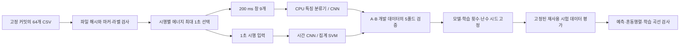
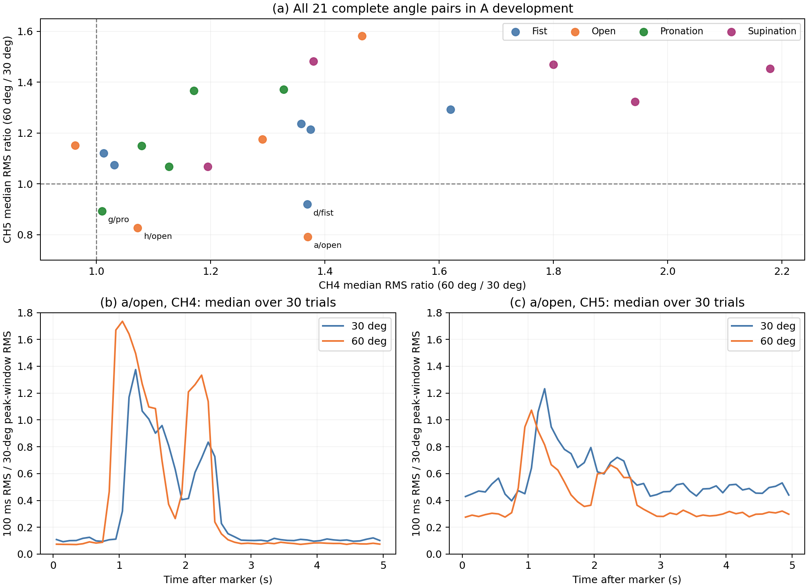
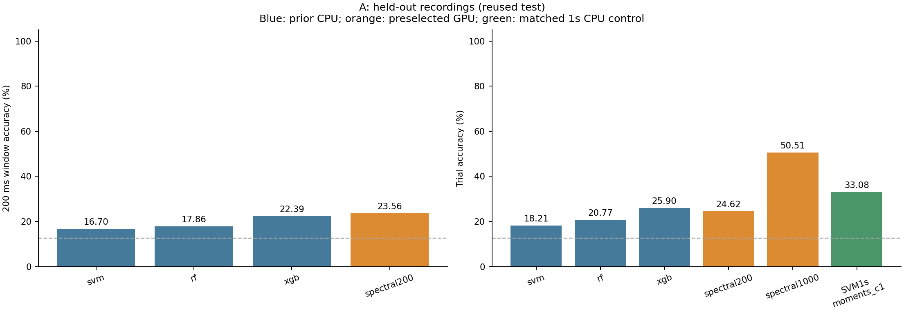
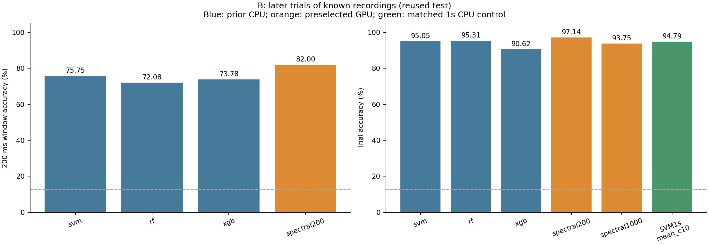
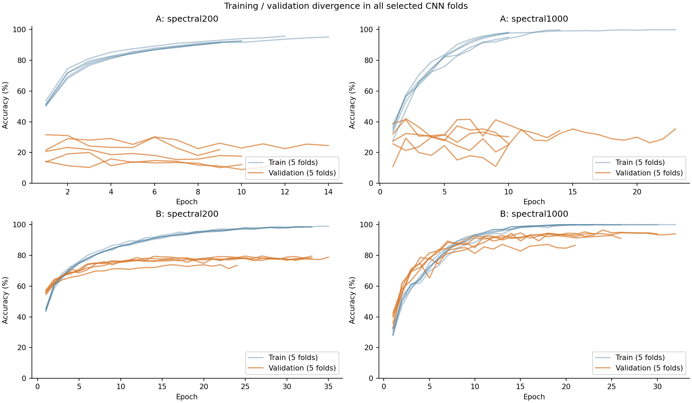
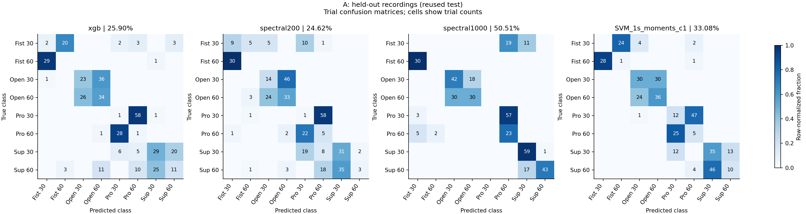
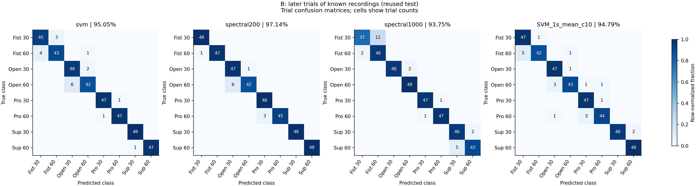

# Step2 — sEMG 손동작·팔꿈치 각도 분류

이 과제는 5채널 표면 근전도(surface electromyography, sEMG)로 손동작 4종과 팔꿈치 각도 2종의 조합, 총 8개 클래스를 분류한다. 입력 신호의 시간 변화를 활용하기 위해 사용자 PC의 TITAN Xp GPU에서 합성곱 신경망(convolutional neural network, CNN)을 학습하고, 기존 CPU 분류기와 같은 평가 분할에서 비교했다.

기록을 나눈 <strong>A 조건에서 1초 CNN의 시행 정확도는 50.51%</strong>로, 같은 1초 신호를 집계한 CPU SVM의 33.08%보다 높았다. 같은 기록의 앞선 시행으로 학습한 <strong>B 조건에서는 200 ms CNN의 창 정확도가 82.00%, 시행 다수결 정확도가 97.14%</strong>였다. A는 미관측 기록, B는 관측 기록의 후속 시행을 평가하며, 두 조건 모두 참가자 자체를 분리한 평가는 아니다.

분석은 “같은 손동작이라도 팔꿈치 각도에 따라 이두근과 삼두근이 서로 다르게 반응할 수 있는가?”라는 질문에서 출발했다. 채널별 관찰, 입력 구간 선정, 분할과 모델 선택, 전체 실험 결과 및 재현 방법을 아래에 정리한다.

## 1. 데이터와 분류 대상

| 항목 | 내용 |
|---|---|
| 대상 | 익명 참가자 a–h, 총 8명 |
| 기록 | 사람별 8개 조건, 총 64개 CSV |
| 반복 | 기록당 30개 시행, 총 1,920개 시행 |
| 입력 | 이미 필터링된 5채널 신호, 1,000 Hz |
| 동작 | fist, open, pro, extor |
| 각도 | 30°, 60° |
| 클래스 | 동작×각도, 총 8개 |
| 원자료 | [공개 저장소](https://github.com/TestUser-alt-dev/sEMG-Hand-Gesture-Elbow-Angle-Dataset) |
| 고정 커밋 | `cb64ded658b83ae97e6388dd373efad0e97bc47c` |
| 관련 논문 | [Lee 등, 2026, Biomedical Engineering Letters](https://link.springer.com/article/10.1007/s13534-026-00607-7) |

| 클래스 ID | 손동작 | 팔꿈치 각도 |
|---:|---|---:|
| 0 | 주먹쥐기(fist) | 30° |
| 1 | 주먹쥐기(fist) | 60° |
| 2 | 손펴기(open) | 30° |
| 3 | 손펴기(open) | 60° |
| 4 | 회내(pro) | 30° |
| 5 | 회내(pro) | 60° |
| 6 | 회외(extor) | 30° |
| 7 | 회외(extor) | 60° |

여기서 <strong>기록(recording)</strong>은 한 참가자가 하나의 동작·각도 조건을 반복한 CSV 파일이고, <strong>시행(trial)</strong>은 그 기록 안에서 수행한 한 번의 반복이다. <strong>창(window)</strong>은 시행에서 추출한 200 ms 길이의 신호다. 파일명에 쓰인 `extor`는 원 제공자의 설명에 따라 회외로 해석했다.

클래스 번호는 현재 코드의 동작 우선 순서다. 이전 1주차 설계안과 강의의 혼동행렬은 각도 우선 순서를 사용하므로, 자료를 대조할 때에는 숫자 ID가 아니라 동작·각도 이름을 기준으로 연결한다. 최종 강의본 21쪽의 각도판 사진과 설명에 따르면, 참가자는 앉아서 테이블 위에 팔을 놓고 판의 30° 또는 60° 기준선에 맞춘 정적 자세를 유지했다. 여기서는 이 두 측정 조건을 파일 라벨로 사용한다. 사진에는 두 경사 기준선이 보이지만 해부학적 각도의 영점과 기준축을 정량 정의한 도식은 제시돼 있지 않다. 분류 대상은 이 두 자세 조건이다.

두 분류 요인을 하나의 8클래스로 묶으면 손동작·각도 조합을 한 번에 출력할 수 있다. 손동작과 각도를 별도로 예측하면 요인별 오류를 구분하기 쉽지만, 두 예측의 일관성을 별도로 평가해야 한다. 각도를 3종 또는 4종으로 늘리면 조합은 12개 또는 16개가 되어 조건별 데이터 확보와 인접 각도 구분이 추가 과제가 된다. 이번 실험은 8클래스 단일 출력을 유지했다.

채널과 근육의 대응은 최종 강의본 20쪽의 전극 사진·표와 고정 커밋의 [데이터 README](https://github.com/TestUser-alt-dev/sEMG-Hand-Gesture-Elbow-Angle-Dataset/blob/cb64ded658b83ae97e6388dd373efad0e97bc47c/README.md)에 따른다.

| 채널 | 데이터 설명의 근육명 | 한국어 명칭 |
|---|---|---|
| CH1 | Extensor carpi radialis | 요측수근신근 |
| CH2 | Extensor digitorum | 총지신근 |
| CH3 | Flexor digitorum superficialis | 천지굴근 |
| CH4 | Biceps brachii | 상완이두근 |
| CH5 | Triceps brachii | 상완삼두근 |

파일명, 마커, 라벨과 채널 수는 원자료에서 검사했고, 파일별 해시는 [manifest](reference/corrected_v3/preprocessing/manifest.json)에 보존했다. 근육명은 제공된 측정 설명에 근거한다. 강의 사진에는 CH1·CH2가 전완 후면, CH3가 전완 전면, CH4가 상완 전면, CH5가 상완 후면에 배치돼 있다. 이 사진은 측정 배치의 설명 자료이며, 64개 기록 각각의 전극 상태와 동작 시점을 확인할 동기 영상은 없다.

관련 논문의 공개 초록은 랜덤 포레스트(random forest, RF)의 5폴드 평균 정확도를 <strong>96.72±0.58%</strong>로 보고했다. 최종 강의본 24·35쪽은 논문의 평가를 시행 단위 무작위 분할로 설명한다. 본문에서 논문의 상세 방법을 언급하는 부분은 이 강의 설명에 근거하며, 구독 제한으로 미확보인 논문 전문을 직접 확인한 범위와는 구분한다. 아래 A/B 실험은 입력 구간과 분할이 달라 동일 조건의 재현 결과가 아니다.

## 2. 신호 전처리와 입력 구간



원 제공자는 신호에 60 Hz 노치 필터와 20–450 Hz 대역 통과 필터를 적용했다고 설명한다. 이번 실험은 제공된 필터링 신호를 그대로 사용했다.

데이터 설명의 명목상 시행 구성은 휴식 2초, 동작 1초, 휴식 2초다. 그러나 마커와 실제 동작의 시간 관계는 확인되지 않았다. A 개발 시행 1,530개 중 1,279개(83.59%)에서 마커 뒤 1–2초의 합산 에너지가 가장 컸다. 이에 따라 기존 CPU 실험과 같은 **신호 에너지 기준의 1초 구간 선택**을 적용했다.

1. 현재 마커부터 다음 마커 직전까지를 한 시행으로 구분한다.
2. 마커 뒤 0.5–3.5초를 시작점으로, 0.1초 간격의 1초 후보 구간을 만든다.
3. 5채널의 신호 제곱합이 가장 큰 구간을 선택한다. 에너지가 같으면 앞선 구간을 선택한다.
4. 선택한 1초 전체를 입력하거나, 200샘플 창을 100샘플씩 이동시켜 9개의 창을 만든다.

구간 선택은 해당 시행의 신호만 사용한다. 라벨, 다른 시행의 통계와 시험 점수는 사용하지 않는다. 다만 약 5초의 시행과 그 경계를 먼저 확보해야 하므로, 전체 처리 지연은 창 길이인 200 ms보다 길다. 에너지 합산에는 큰 진폭의 채널이 더 많이 기여한다. A 개발 시행의 3.92%에서는 한 채널이 선택 구간 에너지의 80%를 넘었다.

64개 원자료의 해시와 기존 창 시작점·정답이 모두 일치했다. 기존 특징의 앞 25열을 다시 계산한 최대 절대 오차는 **0.0**이었다. 검사 항목과 결과는 [데이터 검사 기록](reports/data/audit.json)에 있다.

### 강의 실습과 이번 실험의 관계

1주차 18쪽, 2주차 19쪽, 3주차 19쪽과 최종 강의본 57쪽의 본문·코드·그림을 대조했다. 2주차 자료는 2초 분석 구간에서 200 ms 창을 100 ms씩 이동해 19개의 창을 만드는 실습을 설명한다. 10쪽의 시작점 1.5초는 실습 가정으로 제시돼 있으며, 데이터의 동작 위치를 확인해 조정하도록 안내한다.

| 항목 | 강의의 기본 조건 | 이번 실험과 선택 이유 |
|---|---|---|
| 필터 | 60 Hz 노치, 20–450 Hz 4차 Butterworth; 예제는 Q=30과 `filtfilt` 사용 | 제공 신호에 이미 해당 대역의 필터가 적용돼 있어 추가 필터링 없이 사용 |
| 분석 구간 | 2초, 예제 시작점 1.5초 | 기존 CPU 기준선과 비교하기 위해 에너지로 선택한 1초 유지 |
| 창 | 200 ms, 100 ms 간격, 19개 | 창 길이와 간격은 같고, 입력 구간이 짧아 9개 |
| 기본 특징 | RMS·MAV·WL·ZC·SSC × 5채널 = 25개 | 같은 순서와 계산식 유지; ZC 임계값 0.01, SSC는 기울기 부호 변화 횟수 |
| 확장 입력 | 25개 시간영역 특징 | 일부 CPU 비교에 70개 특징을, CNN에는 원파형 또는 STFT를 사용 |
| 분할 | 같은 시행의 겹치는 창을 분리하지 않음 | 실제 파일당 30개 시행을 식별하고 A는 기록, B는 시행 단위로 분리 |
| 표준화 | 학습 자료에서만 통계 계산 | 각 CV 학습 폴드에서 계산하고 검증·시험에는 적용만 수행 |
| 평가 목적 | 시행 단위 무작위 분할, 80/20 및 5폴드 | A는 기록 이동의 성능 저하, B는 같은 기록의 후속 시행을 평가 |
| 모델 설정 | SVM C=1, RF 100트리, XGBoost 400트리·깊이6·학습률0.05 | 기존 CPU 검증에서 고른 설정을 보존하고, CNN 후보는 별도 사전 계획에 따라 선택 |

강의 예제 13쪽의 파일 단위 분할은 한 파일을 하나의 시행처럼 다룬다. 실제 제공 파일에는 30개 마커가 있으므로, 이번 구현에서는 파일과 시행을 구분해 그룹을 보존했다. 특징을 먼저 캐시하더라도 각 특징이 해당 창 안에서만 계산되고, 그룹 분할과 학습 통계 계산을 독립적으로 관리하면 겹치는 창의 분할 간 혼입을 검사할 수 있다.

200 ms 창과 50% 겹침은 강의의 특징 추출 조건을 유지한 선택이다. 100 ms마다 새 창을 얻어 인접 시간 변화를 살피되, 겹친 표본을 독립 시행으로 취급하지 않도록 같은 시행을 묶었다. 최종 강의본 11·54쪽은 1D CNN과 주파수 특징을 확장 비교로 제안한다. 이번 실험은 그 확장 방향에서 시간 구조의 효과와 기록 간 성능 차이를 검토했다.

강의가 설명하는 논문 방법에서도 2초 구간의 정확한 시작점, 창을 모델의 표본으로 구성하는 세부 방식, 표준화의 적용 순서는 불명확한 항목으로 남아 있다(최종 강의본 23–30·53쪽). 이 저장소에서는 구간 선택, 창 다수결, 학습 폴드별 정규화를 별도 구현 조건으로 명시했다.

1주차의 클래스·채널 설계와 각도별 관찰은 1·4절, 2주차의 특징·그룹 분할은 이 절과 3절, 3주차의 모델·지표·혼동행렬·한계는 5–9절에 대응한다. 공개 저장소는 이 확장 실험의 보고서다. 강의가 별도로 요구한 노트북 또는 PDF, `dataset.npz`, 필터 전후 스펙트럼과 같은 제출 묶음의 완성 여부는 별도이며, 이미 필터링된 제공 신호로 필터 적용 전 원신호를 복원할 수는 없다.

## 3. 평가 분할과 지표

| 구분 | A: 미관측 기록 | B: 관측 기록의 후속 시행 |
|---|---|---|
| 개발/시험 | 기존 51/13개 기록 | 각 기록의 1–24/25–30번째 시행 |
| 개발/시험 시행 수 | 1,530/390 | 1,536/384 |
| 개발/시험 200 ms 창 수 | 13,770/3,510 | 13,824/3,456 |
| 검증 | 개발 기록을 클래스별 5폴드 | 첫 24시행을 연속 5블록으로 분리 |
| 같은 기록이 양쪽에 존재 | 없음 | 있음 |
| 참가자 자체의 분리 | 아님 | 아님 |

A의 시험 13개 기록은 6명의 참가자에게서 나왔다. 개발 데이터와 시험 데이터에 같은 참가자가 포함될 수 있으므로, A가 측정하는 대상은 **참가자가 겹칠 수 있는 미관측 기록의 분류 성능**이다. B는 각 기록의 첫 24개 시행으로 개발한 모델을 같은 기록의 마지막 6개 시행에 적용한다. B의 개발 교차검증에는 앞뒤 블록이 서로 학습·검증 자료가 되는 조합이 있으며, 최종 시험만 시간상 후속 시행으로 구성된다.

기존 `split.npz`의 인덱스를 그대로 사용했다. 같은 시행에서 나온 겹치는 창은 모두 같은 분할과 폴드에 배정했으며, 서로 다른 시행에서 추출한 원신호 구간의 중복도 검사했다. 입력 정규화 통계는 각 학습 폴드에서만 계산했다. 참가자 ID와 기록 ID는 모델 입력에 포함하지 않았다.

**창 정확도**는 200 ms 창의 정답 비율이다. **시행 정확도**는 시행별 정답 비율이며, 200 ms 모델은 한 시행의 9개 창 예측을 다수결로 합친다. 동률이면 가장 작은 클래스 ID를 선택한다. 1초 모델은 시행당 하나의 예측을 직접 출력한다. **정밀도**는 특정 클래스로 예측한 표본 중 실제 그 클래스인 비율이고, **재현율**은 해당 클래스의 실제 표본 중 맞힌 비율이다. **macro-F1**은 클래스별 정밀도와 재현율로 계산한 F1의 단순 평균으로, 각 클래스에 같은 가중치를 둔다. 정밀도와 재현율도 클래스별 값을 단순 평균해 macro 값으로 제시한다. 예측이 없는 클래스의 정밀도는 0으로 처리한다. 두 정확도의 차이는 %p(퍼센트포인트)로 표시한다.

두 시험 데이터는 이전 실험에서도 사용된 **회고적 재사용 시험 자료**다. 이번 실험의 모델 선택에는 개발 교차검증만 사용했지만, 시험 자료 자체가 처음 공개되는 독립 평가 조건은 아니다. 또한 제공자의 필터 적용 범위와 경계 처리가 상세히 알려지지 않아, 원자료 생성 단계의 시행 간 필터 영향은 이번 구간 중복 검사로 판단할 수 없다.

## 4. 이두근·삼두근 반응에 대한 가설과 관찰

### 4.1 질문을 관찰 가능한 비교로 정의

분석을 시작할 때 세운 가설은 **같은 손동작에서도 각도에 따라 이두근과 삼두근의 반응 방향이 다를 수 있다**는 것이다. 이를 신호에서 확인하기 위해, 같은 참가자·같은 손동작의 30°와 60° 기록에서 CH4와 CH5의 진폭 변화 방향을 비교했다.

진폭 요약에는 제곱평균제곱근(root mean square, RMS)을 사용했다. 채널의 신호 표본을 $x_n$이라고 할 때, 선택한 1초 구간의 RMS는 다음과 같다.

$$
\mathrm{RMS}=\sqrt{\frac{1}{N}\sum_{n=1}^{N}x_n^2},\qquad N=1000.
$$

각 기록의 30개 시행에서 RMS를 구한 뒤 중앙값을 계산했다. 아래 변화율은 **60° 기록의 중앙값을 30° 기록의 중앙값으로 나눈 비율에서 1을 뺀 값**이다. 따라서 서로 다른 두 기록의 대표값을 비교하며, 30°의 특정 시행과 60°의 특정 시행을 일대일로 대응시킨 통계는 아니다.

분석 범위는 두 각도 기록이 모두 A 개발 데이터에 포함된 21개 참가자·동작 쌍, 총 42개 기록으로 제한했다. 8명의 참가자가 여러 동작에 반복 포함되며, 21쌍을 독립된 21명으로 볼 수는 없다. 이 절은 문서 보완을 위한 기술통계 분석이며, 분류 모델의 입력·선택·시험 결과에는 반영하지 않았다.

### 4.2 실제 신호와 RMS 결과

21쌍 중 **CH4 증가·CH5 감소는 4쌍**, 두 채널 모두 증가는 16쌍, CH4 감소·CH5 증가는 1쌍이었다. 증가와 감소는 비율이 1보다 큰지 작은지로 구분했다. 통계적 유의성 검정은 수행하지 않았다.

| 참가자·동작 | CH4 RMS 변화율 | CH5 RMS 변화율 | 관찰 |
|---|---:|---:|---|
| a·손펴기 | +37.0% | −20.8% | CH4 증가·CH5 감소 |
| d·주먹쥐기 | +36.9% | −8.0% | CH4 증가·CH5 감소 |
| g·회내 | +1.0% | −10.7% | CH4 증가·CH5 감소 |
| h·손펴기 | +7.2% | −17.3% | CH4 증가·CH5 감소 |
| a·주먹쥐기 | +62.0% | +29.2% | 두 채널 모두 증가한 비교 사례 |



*그림 1. A 개발 데이터의 각도별 채널 반응. (a) 21개 쌍의 60°/30° 기록별 RMS 중앙값 비율이다. 점선은 비율 1이며, 오른쪽 아래의 네 점은 CH4 증가·CH5 감소 사례다. (b), (c)는 참가자 a의 손펴기 기록에서 마커 이후 100 ms 비중첩 구간별 RMS를 계산하고, 각 시점에서 30개 시행의 중앙값을 구한 결과다. 두 각도의 곡선은 해당 채널의 30° 기록에서 얻은 ‘에너지 최대 1초 RMS 중앙값’으로 나눴다. 따라서 아래 곡선은 시간 변화의 요약이며, 위 표의 1초 RMS 비율과는 집계 구간이 다르다.*

참가자 a의 손펴기 원파형을 확인하고 30개 시행의 RMS 시간 변화를 함께 비교했다. CH4에서는 마커 뒤 약 1–2.5초에 두 각도 모두 진폭이 커졌고, 60°의 증가가 더 컸다. CH5의 60° RMS는 30°보다 낮은 구간이 많았으며, 이 차이는 CH4의 진폭 증가가 두드러진 구간 밖에서도 관찰됐다.

이전 1주차 최종 보고서의 같은 손펴기 사례는 마커 뒤 **5초 전체**를 요약해 CH4 비율 1.504, CH5 비율 0.704를 보고했다. 원자료를 같은 방식으로 재계산한 값도 소수점 셋째 자리에서 일치했다. 이번 표의 +37.0%, −20.8%는 **에너지로 선택한 1초**의 결과다. 같은 기록이라도 요약 구간에 따라 크기가 달라지므로, 이전 관찰과 현재 입력 구간의 수치를 구분한다.

이 결과는 두 채널이 항상 같은 방향으로 변하는 것은 아니라는 관찰을 뒷받침한다. 동시에 두 채널이 함께 증가한 16쌍은 ‘각도가 커지면 CH4는 증가하고 CH5는 감소한다’는 규칙이 전체 자료에 적용되지 않음을 보여준다. 특히 g의 회내에서 CH4 변화는 +1.0%로 작아, 방향 구분만으로 큰 반응을 의미하지 않는다.

### 4.3 생리적 해석의 범위

CH4와 CH5의 대응 근육은 데이터 설명으로 확인했지만, RMS는 기록된 전기 신호의 크기다. sEMG 진폭에는 신경 구동뿐 아니라 운동단위 활동전위의 형태와 측정 조건도 영향을 준다([Farina 등, 2014](https://pmc.ncbi.nlm.nih.gov/articles/PMC4254845/)). 이번 자료에는 근력, 실제 관절 운동 및 전극 상태를 함께 확인할 측정값이 없다.

따라서 확인된 결과는 **일부 참가자·동작 쌍에서 이두근 채널의 RMS가 증가하고 삼두근 채널의 RMS가 감소했다**는 것이다. 삼두근의 실제 이완 여부와 각도가 변화의 직접 원인인지는 추가 측정이 필요하다. 30°와 60°가 별도 기록이므로 각도 차이와 기록 조건의 차이도 함께 고려해야 한다.

## 5. 모델과 선택 절차

### 5.1 후보 모델

CPU 기준선은 서포트 벡터 머신(support vector machine, SVM), RF, XGBoost다. SVM은 클래스 사이의 경계를 학습하며 RBF 커널로 비선형 관계를 표현한다. RF는 서로 다르게 학습한 결정 트리의 예측을 결합하고, XGBoost는 앞선 모델의 오차를 줄이는 방향으로 트리를 순차 추가한다. A의 기존 기준선은 25개 특징, B의 SVM·XGBoost는 70개 특징을 사용했다. 기존 SVM은 RBF 커널·C=10과 로그 특징 변환, RF는 300트리·말단 노드 최소 표본 수 3을 사용했다. XGBoost는 300트리·학습률 0.05이며 선택 깊이는 A 3, B 6이었다. 이 설정들은 강의의 기본값과 구분되는 기존 CV 선택 결과다. B의 RF는 고정 1–2초 구간을 사용하므로, 아래 비교에서 입력 차이를 함께 표시한다.

CNN은 원파형 또는 시간별 주파수 정보를 입력으로 사용한다. 합성곱 필터가 인접 시점의 패턴을 학습하고, 뒤의 층이 채널과 시간 정보를 결합해 8개 클래스의 점수를 출력한다. 단시간 푸리에 변환(short-time Fourier transform, STFT)은 짧은 신호 구간의 주파수 성분을 시간 순서대로 배열한 표현이다.

| 계열 | 입력·구조 | 파라미터 |
|---|---|---:|
| 원파형 CNN | 5채널 → 채널별 Conv1d(15,stride2) → 채널 혼합 Conv(9,stride2) → Conv(5) → 평균/최대 pooling + log-RMS → MLP | 53,720 |
| 주파수 CNN | 64샘플 Hann STFT, hop16 → 5×33=165채널 → Conv1d(1,3,3), 각 64채널 → 평균/최대 pooling → MLP | 44,488 |
| 상대 주파수 CNN | 표본 전체 log-power 평균을 제거한 뒤 동일 CNN | 44,488 |
| 증강 주파수 CNN | 학습 때 공통/채널별 log-gain 증강 후 동일 CNN | 44,488 |
| 집계 SVM | 같은 1초 안 9개 창의 70특징을 평균 또는 평균+표준편차로 집계 | 해당 없음 |

200 ms 입력의 STFT는 9개 프레임, 1초 입력은 59개 프레임으로 구성된다. 패딩을 하지 않아 각 입력의 마지막 8샘플은 STFT에 포함되지 않는다. 1초 CNN은 시행 전체의 시간 순서를 이용하고, 집계 SVM은 같은 1초 안의 9개 창에서 얻은 특징을 평균 또는 평균·표준편차로 요약한다. 1초 모델의 평가 단위는 시행이므로 창 정확도는 정의하지 않는다.

상대 주파수 모델은 표본 전체의 log-power 평균 하나를 제거해 공통 진폭 수준을 줄인다. 증강 모델은 학습 시 공통 자연로그 이득의 표준편차를 0.30, 채널별 자연로그 이득의 표준편차를 0.15로 설정했다. 검증과 시험에는 이득 증강을 적용하지 않았다. 집계 SVM은 RBF 커널과 `gamma=scale`을 사용하고, 평균 벡터는 `C=0.1, 1, 10`, 평균·표준편차 벡터는 `C=1, 10`을 비교했다.

### 5.2 학습과 선택 기준

실제 데이터 학습 전에 [초기 계획](configs/PROTOCOL_GPU.md)을 기록했다. 첫 개발 교차검증에서 기록 간 성능 저하를 확인한 뒤, 시험 평가 전에 [보완 계획](configs/PROTOCOL_EXTENSION.md)을 추가했다. 이 두 파일은 당시의 계획과 해시를 보존한 원본이다. 실행 설정은 [기본 설정](configs/CONFIG_FROZEN.json), [보완 설정](configs/EXTENSION_FROZEN.json), [CPU 대조군 설정](configs/CPU_CONTEXT_CONFIG.json)에 있다.

CNN의 공통 설정은 AdamW, 학습률 0.001, 가중치 감쇠 0.001, 배치 크기 128, 드롭아웃 0.25, 라벨 스무딩 0.05, 기울기 노름 상한 5다. 한 번의 전체 학습 자료 순회를 epoch라고 한다. 교차검증 학습은 최소 8회, 최대 40회 수행하고, 검증 macro-F1이 8회 연속 개선되지 않으면 중단한다. 최적 체크포인트는 첫 epoch부터 기록하므로, 저장된 최적 시점은 최소 실행 횟수인 8보다 작을 수 있다.

모델 선택에는 **5폴드 교차검증(cross-validation, CV)의 평균 macro-F1**을 사용했다. A와 B 각각에서 200 ms 후보 1개와 1초 후보 1개를 선택했다. 200 ms는 창 macro-F1, 1초는 시행 macro-F1을 기준으로 삼았다. 최종 학습 횟수는 선택 모델의 5개 폴드에서 얻은 최적 epoch의 중앙값으로 고정했다.

최종 CNN은 사전에 지정한 난수 시드(seed) 42와 2026으로 각각 학습한 뒤 두 모델의 클래스 확률을 평균했다. 따라서 CV 표는 폴드마다 하나의 시드로 학습한 결과이고, 시험 표는 두 모델의 확률 평균 앙상블 결과다. 개별 시드의 점수도 결과 JSON에 보존했다.

CNN 8후보×2평가×5폴드의 80회 학습과 CPU 대조군 5후보×2평가×5폴드의 50회 학습을 수행했다. [최종 시험 전 선택 파일 해시](configs/FINAL_EVALUATION_GATE.json)를 저장한 뒤 시험을 평가했다. 개발 결과를 보고 후보를 확장했으므로 CV 점수에는 선택 편향이 포함될 수 있다. 최종 시험 평가 후에는 모델과 설정을 변경하지 않았다.

## 6. 전체 검증 결과

아래 CNN 표의 수치는 5폴드 평균이다. 후보명 끝의 `200`과 `1000`은 입력 길이(ms)를 뜻한다. 굵은 macro-F1은 각 평가·입력 길이 안에서 선택된 값이다.

| CNN 후보 | 단위 | A 정확도 | A macro-F1 | B 정확도 | B macro-F1 |
|---|---|---:|---:|---:|---:|
| raw200 | 창 | 23.16% | 0.2319 | 58.48% | 0.5827 |
| spectral200 | 창 | 23.99% | **0.2421** | 78.05% | **0.7803** |
| spectral_relative200 | 창 | 21.83% | 0.2191 | 73.93% | 0.7390 |
| spectral_aug200 | 창 | 24.15% | 0.2361 | 74.15% | 0.7415 |
| raw1000 | 시행 | 33.39% | 0.3082 | 77.25% | 0.7699 |
| spectral1000 | 시행 | 37.88% | **0.3338** | 93.50% | **0.9348** |
| spectral_relative1000 | 시행 | 34.88% | 0.3077 | 92.25% | 0.9224 |
| spectral_aug1000 | 시행 | 34.84% | 0.3141 | 92.00% | 0.9200 |

A의 `spectral_aug200`은 창 정확도가 기본 주파수 모델보다 높았지만, 선택 기준인 macro-F1은 낮았다. 상대 진폭 정규화와 이득 증강을 추가한 네 후보 모두 해당 입력 길이의 기본 주파수 모델보다 CV macro-F1이 낮았다. 이 결과의 적용 범위는 이번 데이터, 분할과 증강 강도다.

CPU 1초 대조군은 A에서 평균·표준편차와 `C=1`을 사용한 `moments_c1`, B에서 평균과 `C=10`을 사용한 `mean_c10`이 선택됐다.

| CPU 1초 후보 | A 시행 정확도 | A macro-F1 | B 시행 정확도 | B macro-F1 |
|---|---:|---:|---:|---:|
| mean_c01 | 15.06% | 0.1404 | 78.73% | 0.7863 |
| mean_c1 | 18.53% | 0.1702 | 93.67% | 0.9365 |
| mean_c10 | 17.26% | 0.1645 | 95.69% | 0.9567 |
| moments_c1 | 21.24% | 0.1961 | 95.06% | 0.9505 |
| moments_c10 | 20.15% | 0.1885 | 95.59% | 0.9559 |

[전체 GPU CV](reports/all_gpu_cv.csv)와 [전체 CPU 대조군 CV](reports/all_cpu_context_cv.csv)에는 모든 후보의 평균 검증 지표가 있다. 개별 폴드의 점수는 [results](results/) 아래 각 후보의 `cv_summary.json`에 보존했다. CNN의 창 점수와 시행 점수는 서로 다른 표본 단위이므로, 입력 길이별로 나눠 비교한다.

### 폴드별 변동과 CPU 비교의 통계적 범위

아래는 완료된 학습 기록에서 선택 모델의 점수를 모은 표다. 평균은 다섯 폴드에 같은 가중치를 주며, SD는 표본 표준편차(`ddof=1`)다. 3주차 코드 예제의 `np.std` 기본값(`ddof=0`)과 구분하기 위해 정의를 명시했다. A/B 및 창/시행 단위별로 읽는다.

| 조건·모델 | 단위 | 폴드 1–5 정확도(%) | 평균 ± SD(%) |
|---|---|---|---:|
| A · svm | 창 | 13.64, 20.78, 18.67, 12.85, 16.30 | 16.45 ± 3.34 |
| A · rf | 창 | 14.68, 17.93, 22.70, 16.37, 16.26 | 17.59 ± 3.08 |
| A · xgb | 창 | 15.12, 19.19, 21.81, 13.74, 18.89 | 17.75 ± 3.27 |
| A · spectral200 | 창 | 15.82, 31.56, 30.11, 19.11, 23.33 | 23.99 ± 6.81 |
| A · spectral1000 | 시행 | 29.39, 42.00, 41.33, 41.33, 35.33 | 37.88 ± 5.46 |
| A · SVM_1s_moments_c1 | 시행 | 17.88, 20.67, 24.00, 23.00, 20.67 | 21.24 ± 2.38 |
| B · svm | 창 | 71.11, 75.94, 77.60, 75.42, 75.74 | 75.16 ± 2.42 |
| B · rf | 창 | 67.36, 73.06, 74.51, 72.81, 72.70 | 72.09 ± 2.74 |
| B · xgb | 창 | 69.13, 73.78, 77.64, 75.21, 75.52 | 74.26 ± 3.18 |
| B · spectral200 | 창 | 73.92, 78.51, 79.55, 78.68, 79.60 | 78.05 ± 2.36 |
| B · spectral1000 | 시행 | 87.19, 96.56, 94.69, 95.31, 93.75 | 93.50 ± 3.67 |
| B · SVM_1s_mean_c10 | 시행 | 93.12, 96.88, 95.94, 95.62, 96.88 | 95.69 ± 1.54 |

기존 CPU 세 모델의 같은 폴드별 창 정확도에 양측 대응 t 검정을 적용했다. 아래 p 값은 문서 보완 시 보존된 점수로 계산한 것으로, 모델 선택에는 사용하지 않았다.

| CPU 비교 | A p 값 | B p 값 |
|---|---:|---:|
| svm–rf | 0.4135 | 0.0001 |
| svm–xgb | 0.1898 | 0.1309 |
| rf–xgb | 0.8665 | 0.0070 |

A의 세 비교는 모두 p≥0.05였다. B에서는 SVM–RF와 RF–XGBoost가 보정 전 0.05보다 작았다. 다만 B의 RF는 다른 입력 구간을 사용하므로 이 차이는 분류기만의 효과가 아니다. 같은 시행·폴드 배정은 확인했으나, 학습 집합이 겹치는 다섯 CV 점수의 의존성, 이 점수로 후보를 선택한 효과와 다중 비교를 보정하지 않았다. 따라서 이 검정은 해당 개발 결과의 탐색적 요약이며, 별도 자료에서 확인한 우열이나 모델의 동등성을 의미하지 않는다. 원 점수·출처 해시·계산값은 [문서 보완 통계](reports/documentation_statistics.json)에 있다.

## 7. 고정 시험 결과

### 7.1 A: 미관측 기록

| 모델 | 창 정확도 | 시행 정확도 | 시행 macro-F1 |
|---|---:|---:|---:|
| 기존 SVM | 16.70% | 18.21% | 0.1514 |
| 기존 RF | 17.86% | 20.77% | 0.1671 |
| 기존 XGBoost | 22.39% | 25.90% | 0.2173 |
| GPU spectral200 | **23.56%** | 24.62% | 0.2091 |
| GPU spectral1000 | — | **50.51%** | **0.3973** |
| 새 CPU 1초 집계 SVM | — | 33.08% | 0.2727 |

1초 CNN은 390개 시행 중 197개를 맞혔다. 같은 1초를 집계한 CPU SVM의 시행 정확도는 33.08%였다. 두 모델은 신호 범위가 같지만, CNN은 시간별 주파수 배열을 사용하고 SVM은 특징의 요약 통계를 사용한다.

기존 XGBoost의 시행 다수결과 비교하면 1초 CNN은 24.62%p 높았다. 이 비교에는 입력의 시간 문맥, 표현, 학습 단위와 앙상블 차이가 함께 포함된다. 같은 200 ms 창을 입력한 CNN은 XGBoost보다 창 정확도가 1.17%p 높았지만, 시행 다수결 정확도는 1.28%p 낮았다.



*그림 2. A의 13개 시험 기록에서 계산한 모델별 정확도. 창은 3,510개, 시행은 390개다. 1초 모델은 시행 정확도만 표시한다. 점선은 8클래스 균등 무작위 예측의 기대 정확도 12.5%다.*

### 7.2 B: 관측 기록의 후속 시행

| 모델 | 창 정확도 | 시행 정확도 | 시행 macro-F1 |
|---|---:|---:|---:|
| 기존 SVM | 75.75% | 95.05% | 0.9504 |
| 기존 RF | 72.08% | 95.31% | 0.9530 |
| 기존 XGBoost | 73.78% | 90.63% | 0.9058 |
| GPU spectral200 | **82.00%** | **97.14%** | **0.9713** |
| GPU spectral1000 | — | 93.75% | 0.9372 |
| 새 CPU 1초 집계 SVM | — | 94.79% | 0.9477 |

200 ms CNN은 시행 다수결로 384개 중 373개를 맞혔다. 기존 SVM보다 창 정확도는 6.25%p, 시행 정확도는 2.08%p 높았다. **97.14%의 적용 범위는 이미 관측한 64개 기록의 마지막 6개 시행**이다.

B의 기존 RF는 고정 1–2초 구간을 입력으로 사용했고, 다른 주요 비교 모델은 에너지로 선택한 1초 구간을 사용했다. 따라서 RF와의 차이에는 입력 구간 차이도 포함된다. 모델별 입력과 평가 수치는 [전체 비교 CSV](reports/all_comparisons.csv)에 기록했다.



*그림 3. B의 후속 시행에서 계산한 모델별 정확도. 창은 3,456개, 시행은 384개이며, 각 기록의 첫 24개 시행이 개발 자료에 포함된다. 점선은 균등 무작위 예측의 기대 정확도 12.5%다.*

기존 CPU 지표는 보존된 예측에서 다시 계산했다. 이번 PC 실험에서 기존 XGBoost를 다시 학습한 결과는 아니다.

### 7.3 시행 단위의 네 가지 지표

보존된 시행 혼동행렬에서 정밀도와 재현율을 추가 집계했다. 기존 정확도·F1과 예측은 유지했다. 200 ms 모델의 행은 다수결, 1초 모델의 행은 직접 예측이다. A는 클래스별 시행 수가 달라 정확도와 macro 재현율이 다르며, B는 클래스당 48개로 같아 두 값이 일치한다.

| 조건·모델 | 시행 정확도(%) | macro 정밀도 | macro 재현율 | macro-F1 |
|---|---:|---:|---:|---:|
| A · SVM_1s_moments_c1 | 33.08 | 0.2863 | 0.2812 | 0.2727 |
| A · rf | 20.77 | 0.1930 | 0.1688 | 0.1671 |
| A · spectral1000 | 50.51 | 0.3870 | 0.4583 | 0.3973 |
| A · spectral200 | 24.62 | 0.2610 | 0.2292 | 0.2091 |
| A · svm | 18.21 | 0.1866 | 0.1521 | 0.1514 |
| A · xgb | 25.90 | 0.2285 | 0.2167 | 0.2173 |
| B · SVM_1s_mean_c10 | 94.79 | 0.9495 | 0.9479 | 0.9477 |
| B · rf | 95.31 | 0.9533 | 0.9531 | 0.9530 |
| B · spectral1000 | 93.75 | 0.9414 | 0.9375 | 0.9372 |
| B · spectral200 | 97.14 | 0.9730 | 0.9714 | 0.9713 |
| B · svm | 95.05 | 0.9511 | 0.9505 | 0.9504 |
| B · xgb | 90.63 | 0.9113 | 0.9062 | 0.9058 |

8클래스별 정밀도·재현율을 먼저 계산한 뒤 평균하므로, 표의 macro-F1은 평균 정밀도와 평균 재현율의 조화평균과 일반적으로 같지 않다. [문서 보완 통계](reports/documentation_statistics.json)는 창 단위 지표도 포함한다. 혼동행렬의 대각합/전체 합으로 정확도를, 각 클래스의 대각값/열 합과 대각값/행 합으로 정밀도와 재현율을 재계산할 수 있다.

강의의 논문 결과를 비교 배경으로 볼 때에는 출처 내부의 차이도 남아 있다. 최종 강의본 38·45–47쪽은 논문 Table 2의 정확도와 Fig. 5 혼동행렬의 대각합에서 계산한 정확도가 일치하지 않음을 설명한다. 예를 들어 RF는 각각 96.88%와 371/384=96.61%다. 표와 그림의 차이가 발생한 이유는 현재 자료에서 확인되지 않았다. 또한 논문의 96.72±0.58%는 5폴드 평균이고, 이번 B의 97.14%는 시간순으로 남긴 시험 시행의 다수결 결과여서 평가 조건과 집계 방식이 다르다.

## 8. 과적합과 오분류 분석

### 8.1 학습 곡선과 기록 간 차이



*그림 4. 선택된 주파수 CNN의 5폴드 학습·검증 정확도. A/B와 200 ms/1초 입력을 구분했다. 200 ms 패널은 창 정확도, 1초 패널은 시행 정확도다. A에서는 학습 점수 상승에 비해 검증 점수가 낮게 유지됐다.*

A의 학습 정확도는 90–100%까지 높아졌지만 검증 정확도는 낮은 수준에 머물렀다. 선택 모델의 폴드별 최적 시점을 집계한 최종 학습 횟수는 A에서 200 ms와 1초 모두 2 epoch, B에서 각각 25와 18 epoch였다. A의 조기 성능 저하와 B의 높은 성능을 함께 보면, 관측한 기록의 패턴을 학습하는 능력에 비해 기록을 바꿨을 때의 일반화가 제한됐다.

A 개발 데이터에서 기록 간 log-RMS 표준편차는 채널별 0.217–0.333, 기록 내 표준편차는 0.065–0.095였다. 기록 간 진폭 차이가 더 컸지만, 사람·동작·각도·측정 조건이 함께 달라져 각각의 영향을 분리할 수 없었다. 4절의 채널 관찰 역시 기록별 반응이 일정하지 않음을 보여준다. 이 두 관찰만으로 전극 상태나 라벨 오류를 성능 저하의 원인으로 특정할 수는 없다.

### 8.2 A의 각도 혼동



*그림 5. A 시험 시행의 혼동행렬. 행은 정답, 열은 예측 클래스다. 왼쪽부터 XGBoost 시행 다수결, 200 ms CNN 시행 다수결, 1초 CNN, 1초 집계 SVM이다. 셀의 숫자는 시행 수, 색은 정답 클래스별 비율을 나타낸다. 클래스 순서는 1절의 표와 같다.*

1초 CNN의 오류 193개 중 153개(79.27%)는 같은 손동작에서 30°와 60°를 혼동한 경우였다. 주먹쥐기 30°와 60°의 정답 수는 각각 0/30이었고, 회내 30°도 0/60이었다. 회내 30°의 57개 시행을 회내 60°로 예측했다. 반면 회외 30°는 59/60을 맞혔다. 전체 정확도 50.51%에는 이처럼 큰 클래스별 편차가 포함된다.

### 8.3 B의 각도 혼동과 차이의 불확실성



*그림 6. B 시험 시행의 혼동행렬. 왼쪽부터 기존 SVM 시행 다수결, 200 ms CNN 시행 다수결, 1초 CNN, 1초 집계 SVM이다. 행은 정답, 열은 예측이며 숫자와 색의 기준은 그림 5와 같다. 200 ms CNN에서 틀린 11개 시행은 모두 같은 손동작의 두 각도를 혼동한 사례다.*

B의 200 ms CNN에서 가장 많은 오류는 손펴기 60°를 30°로 예측한 6개 시행이었다. [시행별 오분류](reports/misclassified_trials.csv), [기록별 정확도](reports/per_record_accuracy.csv), [오류 유형 집계](reports/failure_modes.csv)에 세부 결과가 있다.

모델 간 시행 정확도 차이의 변동성을 보기 위해 참가자를 묶음으로 재표집하는 대응 부트스트랩을 계산했다. B의 CNN–SVM 차이 2.08%p에 대한 탐색적 95% 구간은 **−0.52에서 4.69%p**로 0을 포함했다. A의 1초 CNN–XGBoost 차이 24.62%p의 구간은 **10.00에서 36.90%p**였다. 참가자 수는 A 6명, B 8명이며, 이 구간은 재사용 시험과 후보 선택에 따른 편향을 보정한 값은 아니다. [불확실성 계산 결과](reports/paired_trial_differences.json)에 비교별 구간을 보존했다.

## 9. 실행 환경과 재현 검사

| 항목 | 실제 실행 |
|---|---|
| GPU | NVIDIA TITAN Xp, 12,288 MiB |
| 드라이버 | 580.178.04 |
| 시스템 CUDA toolkit | 12.6.68 |
| GPU Python | 3.10.12 |
| PyTorch / runtime CUDA | 2.6.0+cu118 / 11.8 |
| cuDNN / NumPy | 90100 / 1.26.4 |
| CPU 대조군 환경 | 기존 Conda base, Python 3.13.9, scikit-learn 1.7.2, NumPy 2.3.5, SciPy 1.16.3 |
| 기록된 최고 GPU 온도 | 80 °C |
| 학습 프로세스의 최대 텐서 메모리 | 200.66 MiB |
| 최대 전체 장치 메모리 사용량 | 1,045 MiB, 다른 프로세스 포함 |

기존 Python 환경과 사용자 PC의 GPU로 실행했다. 패키지 추가 설치나 드라이버·OS 설정 변경은 없었다. 합성 자료로 출력 크기, 손실·기울기의 유한성, 체크포인트 저장·복원과 작은 표본의 학습 여부를 먼저 검사했다. 보완 실험의 합성 검사에서 발생한 float32 반올림 문제는 실제 데이터 학습 전에 수정했고, 원래 실패 로그는 별도로 보존했다.

자원 계획은 GPU 1개, CPU 최대 4스레드, 모델당 250,000개 이하의 파라미터, 학습 프로세스 GPU 메모리 8 GB 이하, 학습 예산 90분이었다. GPU 온도 85°C 이상, 여유 디스크 5 GB 미만, 비유한 수치 또는 데이터·분할 불일치가 발생하면 중단하도록 설정했다. 실제 CNN 학습 합계는 약 6.4분이었다. 폴드별 실행 시간은 저장 로그에 있지만, 기존 CPU 실험은 다른 환경에서 수행됐고 일부 시간은 학습과 평가를 함께 포함한다. 강의가 요구한 동일 장치의 모델별 학습 시간·단일 표본 100회 추론 시간 비교는 확보되지 않았다. 따라서 현재 자원 기록으로 확인되는 범위는 이 실험의 전체 학습 소요와 메모리·온도이며, 모델별 추론 지연은 추가 측정 항목이다.

저장된 예측에서 GPU 80폴드와 CPU 50폴드의 점수를 다시 계산했다. 시험 인덱스 제외, 최적 epoch, 선택 결과, 데이터·코드·계획 해시와 앙상블 확률을 검사했다. 최종 CNN 8개 체크포인트의 정규화는 개발 데이터만 사용했으며, 복원 후 예측 확률의 최대 절대 오차는 **0.0**이었다. [전체 검사](reports/audit.json), [체크포인트 재실행](reports/checkpoint_replay.json), [자원 기록](reports/resources.json)에 결과가 있다.

공개본의 특징 재생성 경로도 검사했다. 70개 특징의 최대 절대 차이는 약 **8.9×10⁻¹⁶**이었고, 원파형 배열·분할·메타데이터 5개 파일은 기존 SHA-256과 모두 일치했다. 이어서 저장 예측으로 모든 CV 점수와 최종 비교표를 다시 계산했다. 이 검사는 완료된 학습 산출물의 재현성을 확인한 것이며, 새 학습이나 시험 후 튜닝은 포함하지 않았다. [공개본 재현 검사](reports/publication_reproduction_check.json)에 검사 범위를 명시했다.

4절의 문서 보완 분석에서는 A 개발 데이터 42개 원자료의 해시를 다시 확인하고, 시행별 RMS를 재계산했다. 보존된 시행 RMS와의 최대 절대 차이는 약 **5.6×10⁻¹⁷**이었다. 기존 분류 점수, 예측, 학습 코드와 선택 파일은 유지했다.

## 10. 저장소 구성과 공개 범위

```text
README.md              # 과제 목적·방법·결과·해석·재현 방법
DATA_PROVENANCE.md      # 데이터 출처, 공개 범위와 특징 재생성
run.py                 # 별도 작업 폴더에서 실행하는 진입점
src/                   # 데이터 복원·검사·학습·평가 코드
configs/               # 초기·보완 계획과 시험 전 고정 설정
reference/             # 기존 분할·예측·원자료 출처와 해시
results/               # 전체 후보의 CV·학습 로그·선택·최종 예측
reports/               # 비교표·혼동행렬 CSV·검사 결과
figures/               # 채널 RMS·모델 비교·혼동행렬·학습 곡선
logs/                  # 실제 실행 로그
runs/                  # 재현 시 생성되는 작업 폴더, Git 제외
```

공개 파일은 코드, 설정, 분할 메타데이터, 예측·지표와 집계 그림이다. 원신호, 특징 행렬, 개별 시행의 채널 통계와 학습 모델은 로컬에 보존한다. 그림 1은 여러 시행을 요약한 통계이며 개별 원파형을 포함하지 않는다.

원 제공자 저장소에는 확인 시점에 별도 LICENSE가 없었다. 이 저장소의 재현 절차는 원출처에서 고정 커밋의 자료를 직접 받은 뒤 특징을 로컬에서 다시 계산한다. 자료의 출처와 포함·제외 범위는 [데이터 출처 문서](DATA_PROVENANCE.md)에 정리했다.

## 11. 재현 방법

아래 명령은 이 PC에서 확인한 기존 환경을 사용하며 패키지를 설치하지 않는다. GPU용 Python에는 PyTorch 2.6/cu118, NumPy와 pandas가, CPU용 Python에는 scikit-learn, SciPy, pandas와 matplotlib가 필요하다. 다른 PC에서는 9절의 버전을 기준으로 호환 환경을 준비한다.

```bash
git clone https://github.com/KyunghoCha/semg-arm-motion-coursework.git
cd semg-arm-motion-coursework

# 이 PC에서 확인한 기존 Python 환경
GPU_PYTHON=/usr/bin/python3
CPU_PYTHON="$(conda info --base)/bin/python"

$GPU_PYTHON run.py download
$CPU_PYTHON run.py features
$GPU_PYTHON run.py prepare
$GPU_PYTHON run.py self-check
$GPU_PYTHON run.py gpu-cv
$GPU_PYTHON run.py gpu-extension-cv
$CPU_PYTHON run.py cpu-cv

# 검증과 모델 선택을 완료한 뒤 최종 평가
$GPU_PYTHON run.py gpu-final
$CPU_PYTHON run.py cpu-final
$CPU_PYTHON run.py report
$GPU_PYTHON run.py verify-checkpoints
```

기본 작업 위치는 `runs/reproduction`이다. 별도 실행에는 모든 명령에 같은 `--workspace runs/새이름`을 붙인다. 기존 작업 폴더의 소스와 실행하려는 소스가 다르면 중단한다. 완료된 CV는 건너뛰며, 중단된 폴드는 처음부터 다시 학습한다. 코드나 설정이 다른 실험은 새 작업 폴더에서 수행한다.

원자료 다운로드는 약 977 MB, 전체 실행 폴더는 약 1.2 GB였으며, 실행 전 여유 공간 5 GB 이상을 검사한다. 실측 CNN 학습은 약 6.4분이었지만 데이터 준비와 CPU 검증에는 별도 시간이 들었다. 실행 시간과 수치의 재현 범위는 GPU, 라이브러리와 운영체제에 따라 달라질 수 있다.

그림 1의 집계 절차는 4절에 정의했다. `prepare`에서 생성한 `trial_audit.json`과 A 분할을 이용해 양쪽 각도가 개발 자료에 있는 21쌍을 찾고, 각 기록의 30개 시행 RMS 중앙값을 비교한다. 시간 곡선은 해당 원자료를 마커 기준 100 ms 비중첩 구간으로 나눈 뒤 각 시점의 시행 중앙값을 계산한다. 기존 `report` 명령은 분류 결과의 그림 2–6을 생성하며, 문서 보완용 그림 1은 이 별도 기술통계 절차로 작성했다.

## 12. 결론과 후속 검증

시간별 주파수를 사용하는 1초 CNN은 A에서 시행 정확도 50.51%를 얻어, 같은 1초를 집계한 CPU SVM의 33.08%보다 높았다. 그러나 주먹쥐기 두 클래스와 회내 30°에서 분류가 실패했으며, 오류의 대부분은 같은 손동작의 각도 혼동이었다. B의 200 ms CNN은 관측 기록의 후속 시행에서 97.14%를 얻었다. 이 두 결과는 **반복 측정한 기록 안의 성능과 다른 기록으로 옮겼을 때의 성능 차이**를 보여준다.

채널 분석에서는 일부 조건에서 CH4 증가·CH5 감소를 확인했지만, 두 채널이 함께 증가한 경우가 더 많았다. 따라서 이두근·삼두근의 반응 차이는 채널별로 확인할 질문이며, 모든 참가자와 동작에 동일한 변화 규칙을 적용할 근거는 부족하다.

다음 검증에는 논문 전문의 평가 조건 확인, 마커와 실제 동작의 동기 측정, 전극·세션 조건을 기록한 추가 수집이 필요하다. 새 참가자와 새 세션을 분리한 시험 자료를 사전에 고정해야 그 범위의 일반화 성능을 평가할 수 있다. 현재 결과는 본문에 정의한 A/B 조건과 재사용 시험 자료에 대한 성능으로 해석한다.

## 참고 자료

- [데이터 설명의 고정 버전](https://github.com/TestUser-alt-dev/sEMG-Hand-Gesture-Elbow-Angle-Dataset/blob/cb64ded658b83ae97e6388dd373efad0e97bc47c/README.md): 데이터 구성, 채널·근육 대응, 제공 신호의 필터링.
- [Lee 등, 2026, 원논문 공개 페이지](https://link.springer.com/article/10.1007/s13534-026-00607-7): 초록, 서지와 데이터 가용성. 전문 직접 대조는 미완료이며, 상세 방법의 보충 설명은 아래 강의자료를 출처로 구분했다.
- [Farina, Merletti, Enoka, 2014, The extraction of neural strategies from the surface EMG: an update](https://pmc.ncbi.nlm.nih.gov/articles/PMC4254845/): sEMG 진폭을 신경 구동과 연결해 해석할 때 고려할 요인.
- [Hartwell 등, temporal-to-spatial CNN](https://arxiv.org/html/2007.10879v1): 시간·채널 합성곱과 시행별 분리의 설계 참고 자료. 본 과제의 모델 구조와 설정은 5절에 정의했다.
- [PyTorch 2.6 Conv1d](https://docs.pytorch.org/docs/2.6/generated/torch.nn.Conv1d.html), [재현성 지침](https://docs.pytorch.org/docs/2.6/notes/randomness.html): 신경망 구현과 난수·결정성 설정.
- [그룹 분리 교차검증 문서](https://scikit-learn.org/stable/modules/generated/sklearn.model_selection.StratifiedGroupKFold.html): 그룹 분리 원칙. 실제 실험에는 기존 분할 인덱스를 사용했다.
- `Step2_1주차_강의와실습.pptx`, 1–18쪽: 문제·클래스 설계, 채널과 신호 관찰.
- `Step2_2주차_강의와실습.pptx`, 1–19쪽: 전처리·특징·분할·제출 요구.
- `Step2_3주차_강의와실습.pptx`, 1–19쪽: 네 지표, CV 평균·표준편차, 대응 검정과 계산 비용.
- `Step2_sEMG_팔동작예측_강의_논문내용 추가_최종수정본.pptx`, 1–57쪽: 측정 배치 19–22쪽, 전처리·분할 23–30·35쪽, 논문 결과와 한계 38–52쪽, 확장 과제 53–55쪽. 강의 원본과 강의에 실린 논문 그림은 공개 저장소에 포함하지 않는다.
- 1주차 최종 분석 보고서(2026-10-13), 11–14쪽: 손펴기 원파형·시간별 RMS·CH4/CH5 비교. 해당 사례를 보존된 원자료와 재대조했다.
