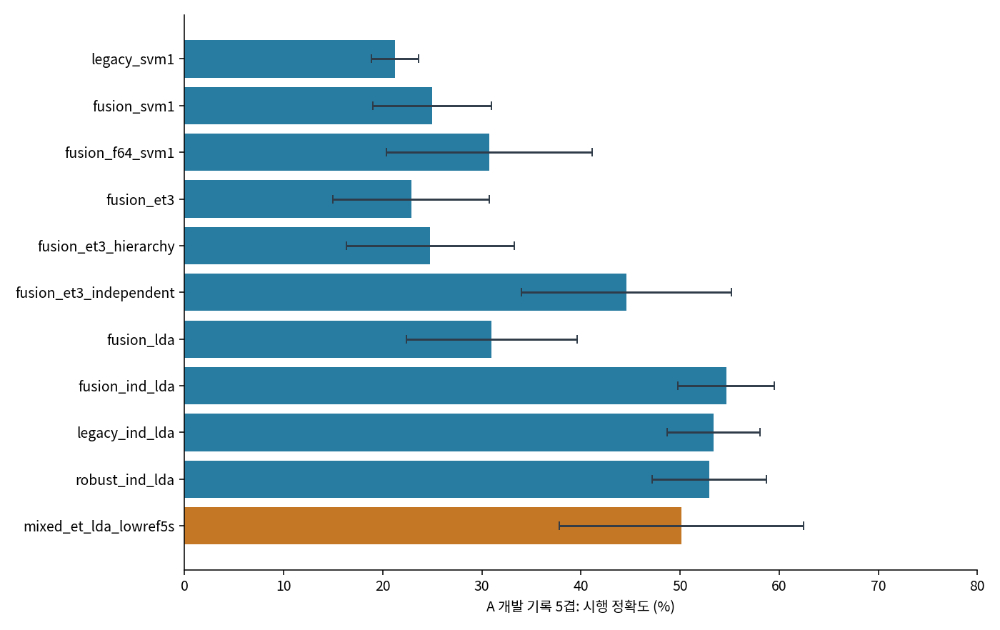
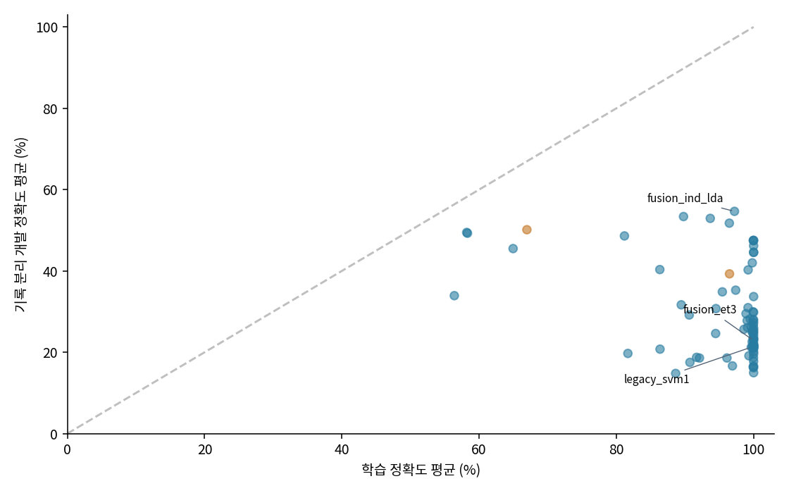
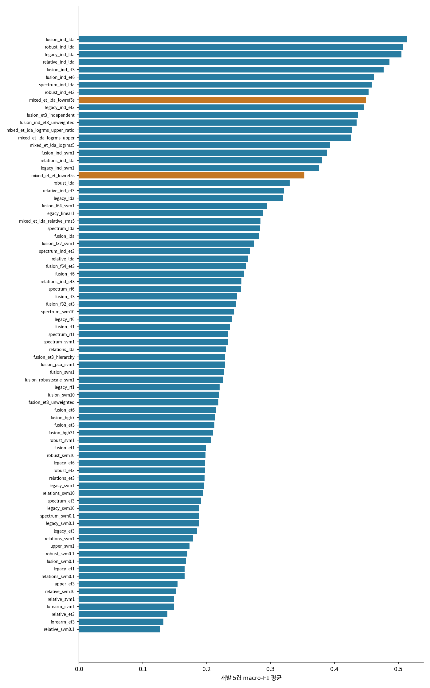
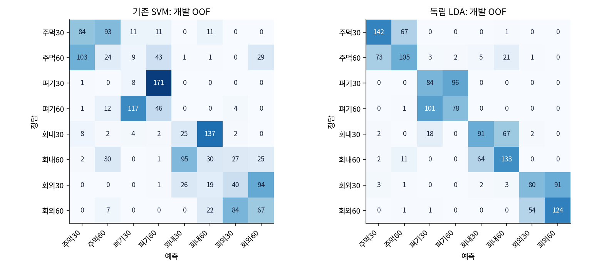
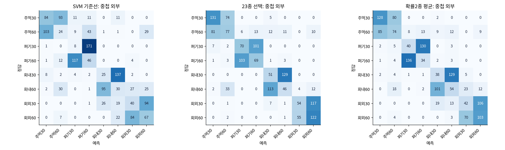
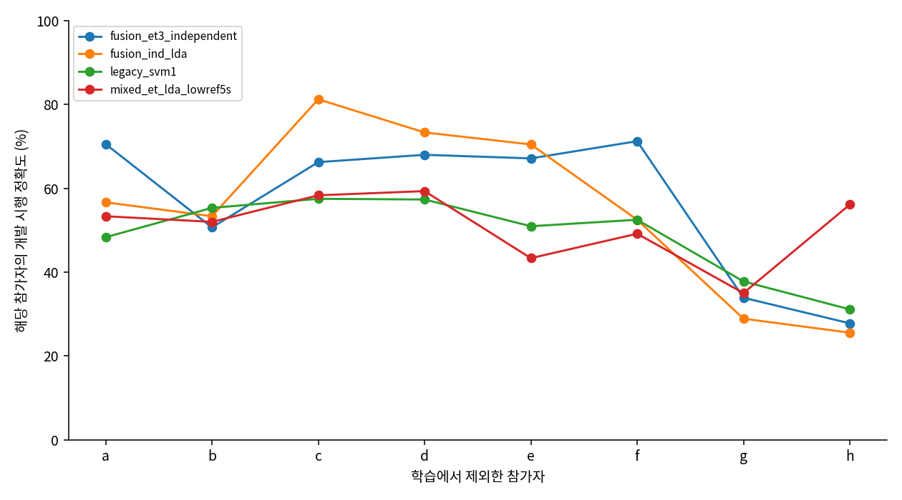

# 전통 머신러닝 중심의 팔 동작 분류 탐색

기존 에너지 기준 1초 입력을 중심으로 A 개발 기록 분할에서 79개 후보를 비교했다.
77개 후보는 1초 입력만 사용하고, 2개 후보는 같은 시행의 5초에서 낮은 진폭 기준을 추가했다.
손동작과 각도를 각각 학습한 공분산 축소 선형판별분석(LDA)이 개발 평균 정확도
54.65%, macro-F1 0.5138로 선택됐다.
기존 집계 SVM의 개발 정확도는 21.24%였다.
**이 수치는 개발 자료에서 후보를 선택한 결과다. 이번 ML 단계에서는 기존 A/B 시험을 평가하지 않았다.**
논문의 약 96.72% 수준에 도달했다는 근거는 확보하지 못했다.

## 1. 문제와 평가 범위

과제는 8명의 5채널 신호로 4개 손동작과 팔꿈치 30°/60°를 구분하는 8클래스 분류다. 기존 A 개발 자료는
51개 기록, 1,530개 시행이다. 한 기록에 같은 참가자·클래스의 30개 시행이 들어 있다.
기록을 제외하면 그 사람의 해당 클래스 예시가 모두 빠지며, 다른 클래스 기록은 남을 수 있다.
새 피험자 평가와는 다른 조건이다.

원자료·강의 확인 범위는 [데이터 출처](../../DATA_PROVENANCE.md)에 있다.
신호는 이미 필터링되어 있고 마커의 생리적 의미가 불확실해, 기존 신호 에너지로
선택한 1초 구간을 유지했다. 새 ML 입력 캐시에는 A 시험 시행을 제외한 1,530행만 저장했다.

| 평가 | 모델 선택과 표본 단위 | 해석 |
|---|---|---|
| 개발 비교 | 기존 A 기록 5겹, 시행 예측 | 79종 선택에 사용한 개발 성능 |
| 고정 23종 중첩 CV | 외부 5겹·내부 3겹 모두 기록 그룹 | 내부에서 선택한 절차의 외부 결과; 적응적 22종은 제외 |
| 새 기록 분할 진단 | 고정 모델, 새 seed 두 개의 기록 5겹 | 분할 구성 민감도; 추가 선택에 미사용 |
| 참가자 제외 진단 | 고정 모델, a–h를 한 명씩 학습에서 제외 | 참가자 변화 민감도; 후보 선택에 같은 개발 자료를 사용한 이력 존재 |
| 기존 A/B 시험 | 이번 단계에서 미사용 | 이전 시험 결과와 노출 이력 보존 |

중첩 CV에서도 과거 이 데이터로 모델을 설계한 이력까지 사라지지는 않는다.
참가자 제외 진단은 각 fit에서 해당 사람을 제외하지만, 모델 선택까지 독립인
중첩 LOSO 평가는 아니다. 새 독립 시험자료는 현재 없다.

## 2. 관찰에서 가설로

앞선 실험은 손동작보다 각도 구분에서 오류가 많았고, 학습 정확도와 기록 분리 검증의
차이가 컸다. 이를 바탕으로 네 가지 질문을 세웠다. 창의 평균만으로 놓친 분포가 있는지,
채널 사이 관계가 필요한지, 불필요한 특징과 복잡한 경계가 과적합을 키우는지,
각도 학습을 손동작별로 나누거나 전체 손동작에서 모으는 것이 어떤 영향을 주는지다.

사용자가 제시한 가설은 같은 손동작에서 이두근과 삼두근의 반응 방향이 다를 수 있다는
것이다. 이전 개발 21쌍의 관찰은 CH4 증가·CH5 감소 4쌍, 두 채널 증가 16쌍,
CH4 감소·CH5 증가 1쌍이었다. 이번 채널 선택·진폭 비율 대조는 그 관찰과
분류 정보의 관계를 살피는 실험이다. 채널 진폭의 변화 방향은 사람·동작에 따라
달랐으며, 실제 근력이나 이완을 확인하는 측정은 없었다.

## 3. 특징과 모델

| 특징군 | 차원 | 입력과 목적 |
|---|---:|---|
| legacy | 140 | 기존 70특징 × 9창의 평균·표준편차 |
| robust | 280 | 같은 특징에 중앙값·IQR 추가 |
| spectrum | 105 | Welch 대역전력, 평균·중앙 주파수, 엔트로피·평탄도, RMS |
| relations | 150 | 공분산 행렬 로그, 채널·포락선 상관, 상대 RMS·비율, coherence |
| fusion | 395 | legacy+spectrum+relations |
| relative | 320 | 절대 진폭 일부를 제외하고 상대 전력·trace 정규화 공분산 사용 |
| upper / forearm | 56 / 84 | 기존 특징 중 CH4·5 / CH1–3만 사용 |

Welch 전력 추정에는 길이 256표본의 Hann 창과 128표본 간격을 사용했다.
coherence는 교차 스펙트럼의 크기 제곱을 두 신호의 전력 스펙트럼 곱으로
나눈 값이며, 네 주파수 구간의 평균을 사용했다
([SciPy 정의](https://docs.scipy.org/doc/scipy/reference/generated/scipy.signal.coherence.html)).
공분산은 전체 및 네 대역 FFT 투영 신호에서 계산하고 5% 대각 축소 후 행렬 로그를
벡터화했다. 이는 시행 내부 특징이며 기록 전체의 검증 통계를 학습에 사용하지 않는다.

SVM은 RBF 커널에서 C=0.1/1/10을 비교했다. RF와 ExtraTrees는 300개 트리,
최대 특징 비율 0.5, 말단 최소 표본 1/3/6개, seed=42를 사용했다.
Histogram GB는 100회 반복·학습률 0.05·L2=1·최대 말단 7/31개로 고정하고 내부 무작위
시행 조기종료를 껐다. LDA는 `solver=lsqr, shrinkage=auto`다.
공분산 축소는 특징 수에 비해 표본이 적을 때 추정 변동을 줄이는 규제다
([LDA 공식 문서](https://scikit-learn.org/stable/modules/lda_qda.html)).
공분산 축소를 적용한 LDA와 비선형 분류기의 결과를 같은 기록 분할에서 비교했다.

표준화, RobustScaler, 누적 설명 분산 95%의 PCA와 특징 선택은 각 학습 폴드에서만 fit했다.
F통계 특징 선택은 학습 기록별 특징 중앙값을 사용해 같은 기록의 반복 시행을
독립 기록처럼 계산하지 않았다. 선택 개수 32/64는 후보 설정으로 사전 고정했다.
SVM 확률 보정용 내부 무작위 CV는 사용하지 않았다.

분류 구조는 8클래스 직접 분류, 4동작·2각도의 독립 분류, 손동작별 2각도 계층
분류를 비교했다. 독립 구조는 각도 학습에 모든 손동작의 표본을 모은다.
계층 구조는 추론할 때 손동작의 정답을 주지 않고, 예측한 동작 확률과 조건부
각도 확률을 곱한다. 모델별 실제 설정은 [고정 설정](artifacts/results/CONFIG_FROZEN.json)에 있다.

## 4. 단계별 판단과 요인별 비교

초기 57종은 특징군·모델군·규제와 구조를 비교했다. 여러 요소가 함께 바뀐 결합 특징
비교는 탐색으로 표시했다. 이어 독립 구조의 이득을 확인하기 위해 22개 대조군을
추가했다. 손동작 모델을 고정하고 각도 입력을 줄이는 대조도 포함했다.
모든 시도의 관찰→가설→변경/고정 조건→결과/변동→해석→결정은
[전체 실험 기록](EXPERIMENT_LOG.md)에 후보별로 정리했다.

| 같은 조건에서 비교한 변화 | 개발 정확도(%) | 해석 범위 |
|---|---:|---|
| fusion ExtraTrees 직접→독립 | 22.88→44.59 | 분류 구조의 영향 |
| fusion LDA 직접→독립 | 30.97→54.65 | 같은 특징·LDA에서 구조 비교 |
| 독립 LDA legacy→fusion | 53.38→54.65 | 특징 결합의 추가 이득은 작음 |
| fusion SVM 전체→F상위64 | 24.99→30.74 | 학습 기록 기준 특징 선택 효과 |
| fusion 독립 ExtraTrees leaf3→6 | 44.59→47.46 | 트리 복잡도 변화 |



*그림 1. 같은 개발 기록 5겹에서의 시행 정확도 평균과 표준편차.
주황색은 5초의 낮은 진폭 기준을 추가한 입력이다. 이 후보는 1초 입력과 문맥 길이가 다르다.*



*그림 2. 각 후보의 평균 학습·개발 정확도. 점선은 두 값이 같은 위치다.
많은 후보가 학습 자료를 거의 완전히 맞히면서 기록 분리 개발 점수는 낮았다.*

## 5. 전체 개발 결과

평균과 표준편차는 같은 5개 기록 폴드의 단순 평균과 표본 표준편차(ddof=1)다.
선택 기준은 8클래스 macro-F1 평균이며 동률은 이름순이다. 학습 시간은 5회 fit의
합계로, 특징 계산·저장·보고서 시간은 제외했다. 한 구조가 여러 분류기를 학습하면
그 시간을 모두 포함한다.

| 후보 | 문맥 | 정확도 평균±SD(%) | macro-F1 | 각도 정확도(%) | fit합계(s) |
|---|---|---:|---:|---:|---:|
| `fusion_ind_lda` | 1s | 54.65 ± 4.84 | 0.5138 | 58.84 | 0.52 |
| `robust_ind_lda` | 1s | 52.93 ± 5.77 | 0.5075 | 60.42 | 0.29 |
| `legacy_ind_lda` | 1s | 53.38 ± 4.69 | 0.5049 | 60.93 | 0.13 |
| `relative_ind_lda` | 1s | 51.75 ± 3.61 | 0.4860 | 56.27 | 0.39 |
| `fusion_ind_rf3` | 1s | 47.51 ± 6.40 | 0.4769 | 56.03 | 147.49 |
| `fusion_ind_et6` | 1s | 47.46 ± 11.00 | 0.4623 | 54.90 | 16.92 |
| `spectrum_ind_lda` | 1s | 48.61 ± 6.60 | 0.4581 | 53.27 | 0.11 |
| `robust_ind_et3` | 1s | 47.51 ± 9.64 | 0.4535 | 57.49 | 13.66 |
| `mixed_et_lda_lowref5s` | 5s | 50.14 ± 12.33 | 0.4494 | 59.43 | 3.76 |
| `legacy_ind_et3` | 1s | 46.18 ± 10.22 | 0.4456 | 57.19 | 8.22 |
| `fusion_et3_independent` | 1s | 44.59 ± 10.61 | 0.4364 | 51.73 | 21.00 |
| `fusion_ind_et3_unweighted` | 1s | 44.55 ± 10.88 | 0.4346 | 51.99 | 17.86 |
| `mixed_et_lda_logrms_upper_ratio` | 1s | 49.47 ± 18.74 | 0.4268 | 57.17 | 3.79 |
| `mixed_et_lda_logrms_upper` | 1s | 49.27 ± 18.81 | 0.4254 | 56.98 | 3.80 |
| `mixed_et_lda_logrms5` | 1s | 45.50 ± 17.86 | 0.3927 | 52.75 | 3.91 |
| `fusion_ind_svm1` | 1s | 41.99 ± 5.72 | 0.3881 | 48.21 | 0.82 |
| `relations_ind_lda` | 1s | 40.34 ± 10.82 | 0.3804 | 43.78 | 0.14 |
| `legacy_ind_svm1` | 1s | 40.26 ± 9.01 | 0.3762 | 51.91 | 0.43 |
| `mixed_et_et_lowref5s` | 5s | 39.28 ± 14.69 | 0.3528 | 48.58 | 4.95 |
| `robust_lda` | 1s | 35.27 ± 8.07 | 0.3298 | 43.04 | 0.18 |
| `relative_ind_et3` | 1s | 33.69 ± 13.92 | 0.3207 | 39.97 | 14.73 |
| `legacy_lda` | 1s | 34.85 ± 7.21 | 0.3197 | 42.59 | 0.08 |
| `fusion_f64_svm1` | 1s | 30.74 ± 10.37 | 0.2943 | 36.53 | 0.19 |
| `legacy_linear1` | 1s | 29.95 ± 4.98 | 0.2882 | 43.69 | 0.92 |
| `mixed_et_lda_relative_rms5` | 1s | 33.92 ± 10.44 | 0.2842 | 42.07 | 3.36 |
| `spectrum_lda` | 1s | 31.67 ± 6.33 | 0.2833 | 36.60 | 0.06 |
| `fusion_lda` | 1s | 30.97 ± 8.61 | 0.2818 | 34.97 | 0.26 |
| `fusion_f32_svm1` | 1s | 29.16 ± 9.24 | 0.2744 | 37.57 | 0.17 |
| `spectrum_ind_et3` | 1s | 29.82 ± 6.95 | 0.2675 | 35.81 | 6.50 |
| `relative_lda` | 1s | 29.50 ± 8.34 | 0.2643 | 33.50 | 0.20 |
| `fusion_f64_et3` | 1s | 27.96 ± 6.86 | 0.2619 | 32.99 | 3.02 |
| `fusion_rf6` | 1s | 28.21 ± 8.07 | 0.2583 | 36.22 | 74.36 |
| `relations_ind_et3` | 1s | 27.96 ± 6.48 | 0.2545 | 34.79 | 8.79 |
| `spectrum_rf6` | 1s | 27.78 ± 5.21 | 0.2538 | 35.39 | 21.67 |
| `fusion_rf3` | 1s | 26.69 ± 8.07 | 0.2470 | 34.21 | 79.14 |
| `fusion_f32_et3` | 1s | 26.33 ± 5.27 | 0.2456 | 35.50 | 2.29 |
| `spectrum_svm10` | 1s | 27.28 ± 3.87 | 0.2433 | 33.52 | 0.20 |
| `legacy_rf6` | 1s | 25.65 ± 7.57 | 0.2393 | 37.08 | 26.92 |
| `fusion_rf1` | 1s | 25.44 ± 7.66 | 0.2364 | 32.86 | 84.93 |
| `spectrum_rf1` | 1s | 25.94 ± 4.97 | 0.2338 | 33.21 | 24.61 |
| `spectrum_svm1` | 1s | 26.07 ± 5.46 | 0.2330 | 32.12 | 0.20 |
| `relations_lda` | 1s | 24.61 ± 7.85 | 0.2297 | 28.72 | 0.08 |
| `fusion_et3_hierarchy` | 1s | 24.80 ± 8.48 | 0.2290 | 31.64 | 17.68 |
| `fusion_pca_svm1` | 1s | 25.05 ± 5.54 | 0.2283 | 32.19 | 0.46 |
| `fusion_svm1` | 1s | 24.99 ± 5.97 | 0.2275 | 31.93 | 0.56 |
| `fusion_robustscale_svm1` | 1s | 24.88 ± 7.29 | 0.2250 | 31.46 | 0.86 |
| `legacy_rf1` | 1s | 23.35 ± 8.60 | 0.2205 | 33.97 | 34.20 |
| `fusion_svm10` | 1s | 24.16 ± 5.83 | 0.2194 | 30.64 | 0.57 |
| `fusion_et3_unweighted` | 1s | 23.30 ± 9.04 | 0.2185 | 30.73 | 10.28 |
| `fusion_et6` | 1s | 23.34 ± 7.70 | 0.2145 | 30.12 | 9.89 |
| `fusion_hgb7` | 1s | 22.12 ± 6.01 | 0.2134 | 28.99 | 20.16 |
| `fusion_et3` | 1s | 22.88 ± 7.88 | 0.2120 | 30.10 | 10.04 |
| `fusion_hgb31` | 1s | 21.71 ± 6.29 | 0.2097 | 28.79 | 35.51 |
| `robust_svm1` | 1s | 22.56 ± 1.89 | 0.2069 | 36.56 | 0.46 |
| `fusion_et1` | 1s | 21.55 ± 7.36 | 0.1984 | 28.84 | 12.31 |
| `robust_svm10` | 1s | 21.66 ± 2.16 | 0.1982 | 35.04 | 0.43 |
| `legacy_et6` | 1s | 21.31 ± 6.44 | 0.1972 | 32.88 | 4.60 |
| `robust_et3` | 1s | 21.43 ± 6.43 | 0.1972 | 32.18 | 7.64 |
| `relations_et3` | 1s | 21.01 ± 3.71 | 0.1967 | 29.13 | 4.93 |
| `legacy_svm1` | 1s | 21.24 ± 2.38 | 0.1961 | 35.77 | 0.31 |
| `relations_svm10` | 1s | 20.98 ± 6.03 | 0.1949 | 28.21 | 0.32 |
| `spectrum_et3` | 1s | 21.25 ± 3.82 | 0.1915 | 27.89 | 3.82 |
| `legacy_svm10` | 1s | 20.15 ± 2.31 | 0.1885 | 33.81 | 0.27 |
| `spectrum_svm0.1` | 1s | 20.76 ± 4.77 | 0.1882 | 26.97 | 0.37 |
| `legacy_svm0.1` | 1s | 18.75 ± 2.72 | 0.1879 | 37.94 | 0.50 |
| `legacy_et3` | 1s | 19.59 ± 7.83 | 0.1850 | 31.50 | 4.54 |
| `relations_svm1` | 1s | 19.13 ± 6.86 | 0.1788 | 26.63 | 0.34 |
| `upper_svm1` | 1s | 18.59 ± 4.98 | 0.1731 | 58.81 | 0.25 |
| `robust_svm0.1` | 1s | 17.52 ± 3.46 | 0.1700 | 36.19 | 0.71 |
| `fusion_svm0.1` | 1s | 18.58 ± 8.13 | 0.1672 | 25.50 | 0.89 |
| `legacy_et1` | 1s | 17.78 ± 8.62 | 0.1654 | 29.17 | 5.52 |
| `relations_svm0.1` | 1s | 19.71 ± 6.42 | 0.1654 | 27.85 | 0.49 |
| `upper_et3` | 1s | 18.67 ± 6.03 | 0.1545 | 57.02 | 3.04 |
| `relative_svm10` | 1s | 16.60 ± 6.01 | 0.1522 | 25.48 | 0.51 |
| `relative_svm1` | 1s | 16.40 ± 5.61 | 0.1491 | 25.48 | 0.53 |
| `forearm_svm1` | 1s | 16.65 ± 6.11 | 0.1484 | 25.96 | 0.24 |
| `relative_et3` | 1s | 16.19 ± 4.69 | 0.1383 | 22.67 | 8.72 |
| `forearm_et3` | 1s | 14.96 ± 8.06 | 0.1324 | 25.30 | 3.75 |
| `relative_svm0.1` | 1s | 14.79 ± 5.26 | 0.1266 | 26.26 | 0.88 |



*그림 3. 79개 후보의 개발 macro-F1. 선택 기준에 따른 정렬이며 성능이 하락한 후보도 포함했다.*



*그림 4. 동일한 1,530개 개발 시행의 폴드 밖 예측(OOF). 숫자는 건수, 색은 정답 행별 비율이다.
각 예측은 해당 기록을 학습에서 제외한 모델에서 나왔지만, 이 점수들은 후보 선택에 사용했다.*

대표 모델의 손동작 정확도는 94.70%,
각도 정확도는 58.84%였다. 독립 구조의 개발 이득이
있었지만 각도 구분과 기록별 변동은 남아 있다. CH4·CH5만 사용하거나 진폭을 모두
상대화한 후보도 자동으로 개선되지 않았다.

## 6. 고정 23종의 중첩 평가

외부 폴드별 내부 3겹에서 후보를 선택했다. 단일 선택은 23종 중 macro-F1 최고값,
앙상블은 SVM을 제외한 확률 모델 상위 2개의 동일 가중 평균이다.
모든 선택을 잠근 뒤 외부 결과를 계산했다. 앙상블 가중치를 외부 점수에 맞춰
조정하지 않았다. **이 표는 적응적으로 추가한 독립 LDA 대표의 중첩 성능이 아니다.**

| 절차 | 외부 정확도 평균±SD(%) | 외부 macro-F1 평균 |
|---|---:|---:|
| baseline | 21.24 ± 2.38 | 0.1961 |
| single | 40.52 ± 12.98 | 0.3897 |
| ensemble | 33.36 ± 10.69 | 0.3123 |



*그림 5. 고정 후보 선택 절차의 외부 폴드 예측 합계. baseline은 기존 집계 SVM,
single은 내부 선택 1종, ensemble은 내부 확률 모델 상위 2종의 평균이다.*

## 7. 고정 모델의 분할 민감도

기존 SVM, 초기 대표 ExtraTrees, 전체 1초 대표 LDA, 5초 기준 추가 모델을 고정하고
새 기록 분할 두 개와 참가자 제외 진단을 수행했다. 진단 결과를 본 뒤 대표를 바꾸지 않았다.
`subject`의 평균 정확도는 8명에 동일 가중치를 준다. 각 사람의 기록 수·클래스가
다르므로 아래 F1은 1,530시행 예측을 합친 8클래스 macro-F1이다.

| 고정 모델 | 진단 | 정확도 평균±SD(%) | 합산 macro-F1 |
|---|---|---:|---:|
| `fusion_et3_independent` | record_seed20261022 | 40.09 ± 12.76 | 0.3894 |
| `fusion_et3_independent` | record_seed20261023 | 41.78 ± 10.13 | 0.4116 |
| `fusion_et3_independent` | subject | 56.94 ± 17.42 | 0.5760 |
| `fusion_ind_lda` | record_seed20261022 | 49.53 ± 5.87 | 0.4905 |
| `fusion_ind_lda` | record_seed20261023 | 53.41 ± 12.06 | 0.5280 |
| `fusion_ind_lda` | subject | 55.25 ± 20.09 | 0.5550 |
| `legacy_svm1` | record_seed20261022 | 18.62 ± 7.03 | 0.1805 |
| `legacy_svm1` | record_seed20261023 | 23.25 ± 13.30 | 0.2243 |
| `legacy_svm1` | subject | 48.86 ± 9.59 | 0.4827 |
| `mixed_et_lda_lowref5s` | record_seed20261022 | 44.19 ± 17.43 | 0.4368 |
| `mixed_et_lda_lowref5s` | record_seed20261023 | 44.19 ± 13.87 | 0.4327 |
| `mixed_et_lda_lowref5s` | subject | 50.83 ± 8.23 | 0.4865 |



*그림 6. 각 fit에서 한 참가자의 개발 기록 전체를 제외했다. 후보 선택에는 같은 개발 자료의
이전 결과를 사용했으므로, 이 그림은 독립적인 신규 참가자 시험 성능을 확정하지 않는다.*

## 8. 이전 결과·논문과의 관계

앞선 [GPU·강의 조건 보고서](../generalization_v2/README.md)의 1초 CNN은 기존
A 시험 50.51%, 새 개발 선택 CNN은 45.64%였다. 이 결과는 그대로 보존하며 이번 ML의
개발 54.65%를 그 시험 점수와 직접 비교하지 않는다. B의 97.14%는 동일 기록 내
마지막 6시행, C의 RF 96.20%는 무작위 시행 5겹의 19창 다수결이다.

[논문 공개 초록](https://link.springer.com/article/10.1007/s13534-026-00607-7)의
RF 96.72±0.58%는 확인했지만 전문의 분할·입력 구성이 아직 미확인이다.
따라서 C의 높은 숫자나 이번 개발 개선을 논문 재현 성공으로 해석할 수 없다.
XGBoost/LightGBM/CatBoost는 확인한 기존 환경에 없어서 이번 무설치 후보에 포함하지 않았다.

## 9. 검증·자원·후속 판단

총 827개 모델 fit을 완료했다. 모델 내부의 독립·계층 분류기 수는
서로 다르므로 이것은 최상위 후보/폴드 실행 수다. 합산 fit 시간은
20.84분이며 두 작업을 병렬로 실행한 실제 경과시간과 다르다.
CPU는 최대 2작업×2스레드를 사용했다. 이번 전통 ML 단계는 CPU 실행이며,
GPU 사용 근거는 앞선 TITAN Xp CNN 실험에 있다. 새 설치나 외부 연산은 없었다.

특징 해시·그룹 분할·개발행만 포함됐는지 검사했고, 공분산 정규화와 상관의 이득
불변성도 합성 신호로 확인했다. 기존 SVM의 다섯 폴드 예측은 이전 CPU 결과와 완전히
일치했다. 외부 모델은 저장 후 다시 불러와 예측, 학습 통계와 지표를 검사했다.
확률의 병렬 합산 오차는 1e−12 이내로 허용하고 실제 최대 오차를 기록했다.
근거는 [입력 검사](artifacts/reports/initial_verification.json)와
[외부 재현 검사](artifacts/reports/outer_verification.json)에 있다.

이번 탐색에서는 전통 ML의 분류 구조를 바꿨을 때 개발 성능이 개선됐지만,
논문에 보고된 수치에는 미달했고 평가 조건도 달랐다. 특징·정규화·모델군·복잡도·
채널·분류 구조를 대조한 뒤에도 각도 오류와 분할 변동이 남았다. 같은 개발 기록에서
더 큰 격자를 반복하면 후보 선택 편향이 커지므로, 이번 결과를 고정하고 다음 정보가
필요한 단계로 정리했다. 논문 전문은 정확한 재현 조건을, 독립 세션과 전극 위치·실제
관절각·동작 시점 기록은 각도와 측정 조건의 영향을 구분하는 데 필요하다.
이번 ML 단계에서는 기존 A/B 시험에 대한 추가 튜닝·재평가를 하지 않았다.

## 10. 재현과 파일 구조

```text
experiments/ml_v3/
  PROTOCOL.md, AMENDMENT_1.md, DIAGNOSTICS_PLAN.md
  prepare.py, models.py, train.py, adaptive.py, lock.py
  diagnostics.py, verify.py, report.py
  README.md, EXPERIMENT_LOG.md
  artifacts/  # 설정·집계·예측·로그·그림; 원신호·특징행렬·모델 제외
```

원래 저장소의 데이터 준비와 앞선 `generalization_v2/prepare.py`를 완료한 작업 루트에서
실행한다. 작업 루트 바로 아래에 저장소와 `step2_gpu_pc`, `step2_improvement_v2`,
`step2_ml_v3`가 나란히 놓인다. 새 결과를 재생성할 때에는 비어 있는 별도 루트를 사용한다.
실행과 구문 검사는 conda Python 3.13.9에서 확인했다. 시스템 Python 3.10에서는
특징 준비 코드의 확장 인덱싱 문법이 지원되지 않으므로 아래의 conda 실행기를 사용한다.
라이브러리 버전은 [환경 기록](artifacts/reports/environment.json)에 있다.

```bash
mkdir -p ../step2_ml_v3/{data,results,reports,logs}
PY=/home/ckh/anaconda3/bin/python
$PY experiments/ml_v3/prepare.py
$PY experiments/ml_v3/train.py self-check
# partition0/1은 각 후보를 나누며 동시에 실행할 때 합계4thread
$PY experiments/ml_v3/train.py screen 0
$PY experiments/ml_v3/train.py screen 1
$PY experiments/ml_v3/train.py inner 0
$PY experiments/ml_v3/train.py inner 1
$PY experiments/ml_v3/adaptive.py prepare
$PY experiments/ml_v3/adaptive.py 0
$PY experiments/ml_v3/adaptive.py 1
$PY experiments/ml_v3/lock.py
$PY experiments/ml_v3/diagnostics.py prepare
$PY experiments/ml_v3/verify.py initial
$PY experiments/ml_v3/train.py outer 0
$PY experiments/ml_v3/train.py outer 1
$PY experiments/ml_v3/diagnostics.py 0
$PY experiments/ml_v3/diagnostics.py 1
$PY experiments/ml_v3/verify.py outer
$PY experiments/ml_v3/report.py
```

설정과 선택 파일은 덮어쓰지 않는다. 원신호·특징 캐시·학습 모델은 로컬
`step2_ml_v3`에 있고 검토용 결과 묶음에서 제외했다. 로그 사본의 개인 홈·작업 루트는
치환했으며 원본 로그는 보존했다. 현재 메인 README와 원격 공개 저장소는 변경하지 않았다.
