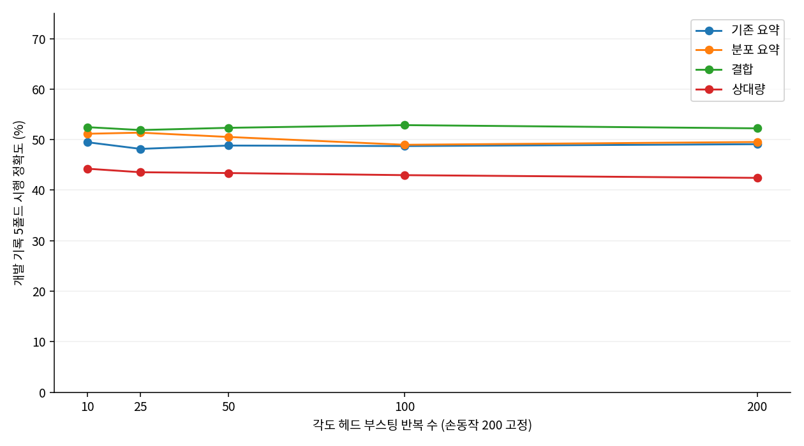

# 각도 학습량 후속 비교

## 관찰·가설·검증

고정 24종 완료 뒤 개발 곡선에서 각도 검증 손실의 상승을 확인했다. 손동작 학습량은 200으로 유지하고 각도만 10·25·50·100으로 줄였다. 깊이 2·4특징군·나머지 파라미터·기록 5폴드는 동일하다. 각 특징의 200라운드 행은 기존 결과를 재사용했다. 추가 비교 전 중첩 결과도 이미 본 상태이며, 이번 결과는 개발 선택만 수행했다. 기존 시험·중첩 외부·참가자 진단은 반복하지 않았다. [추가 전 고정 계획](ANGLE_ROUNDS_PLAN.md)에 범위를 명시했다.

## 결과

| 특징 | 각도 반복 수 | 시행 정확도 평균±SD (%) | macro-F1 | 각도 정확도 (%) | 학습 정확도 (%) |
|---|---:|---:|---:|---:|---:|
| legacy | 10 | 49.48±9.10 | 0.4637 | 60.57 | 79.68 |
| legacy | 25 | 48.18±8.30 | 0.4615 | 60.25 | 84.50 |
| legacy | 50 | 48.84±7.96 | 0.4575 | 60.85 | 88.14 |
| legacy | 100 | 48.73±8.44 | 0.4566 | 60.41 | 92.50 |
| legacy | 200 | 49.10±7.12 | 0.4660 | 60.50 | 96.60 |
| robust | 10 | 51.17±9.34 | 0.4793 | 62.01 | 80.33 |
| robust | 25 | 51.39±10.97 | 0.4856 | 62.30 | 85.07 |
| robust | 50 | 50.53±9.39 | 0.4762 | 61.72 | 89.16 |
| robust | 100 | 48.99±9.18 | 0.4584 | 59.64 | 93.14 |
| robust | 200 | 49.54±9.43 | 0.4673 | 60.12 | 97.22 |
| fusion | 10 | 52.47±9.70 | 0.5024 | 60.70 | 84.07 |
| fusion | 25 | 51.90±9.93 | 0.5024 | 60.59 | 88.08 |
| fusion | 50 | 52.35±8.09 | 0.5061 | 60.83 | 91.56 |
| fusion | 100 | 52.88±6.99 | 0.5087 | 61.50 | 95.23 |
| fusion | 200 | 52.24±9.03 | 0.5050 | 60.62 | 98.37 |
| relative | 10 | 44.25±6.26 | 0.4294 | 50.27 | 81.56 |
| relative | 25 | 43.55±7.28 | 0.4154 | 49.84 | 84.39 |
| relative | 50 | 43.39±7.24 | 0.4073 | 49.21 | 90.46 |
| relative | 100 | 42.98±9.26 | 0.4073 | 48.55 | 94.99 |
| relative | 200 | 42.44±9.53 | 0.4065 | 48.08 | 98.06 |

추가 비교와 기존 기준에서 macro-F1으로 선택된 후보는 `fusion_angle100`다. 정확도 52.88±6.99%, F1 0.5087였다. 이 선택 점수는 외부 성능 추정치가 아니다.

*그림 1. 같은 개발 5폴드의 시행 정확도 평균. 모든 점에서 손동작 반복 수는 200이며 각도 반복 수만 다르다. 후보 선택에는 정확도가 아닌 macro-F1을 사용했다.*

## 비용·해석·다음 선택

80회 추가 학습의 합산 fit 시간은 43.32초였다. 학습 손실 평가를 기록하지 않아 앞선 504회의 fit 시간과 계산 범위가 다르다. 저장 예측에서 80회 정확도와 F1을 다시 계산했고, 기존 200라운드 모델과 손동작 주변확률의 최대 차이는 2.38e-07로 부동소수점 반올림 범위였다. 바꾼 요인이 각도 학습량임을 대조했다.

학습량 감소는 같은 개발 자료에서 과적합 원인을 비교한 대조다. 독립 세션·신규 참가자의 성능은 이 단계에서 측정하지 않았다. 좁은 반복 수를 다시 탐색하거나 외부 결과로 대표를 변경하지 않았다. 전체 정밀 수치와 폴드 변동은 [집계·검사](artifacts/reports/angle_rounds_comparison.json)에 있다. 재현은 루트 README 14.5의 고정 24종 실행을 마친 뒤 `angle_rounds.py`, `angle_report.py` 순서로 수행한다.
