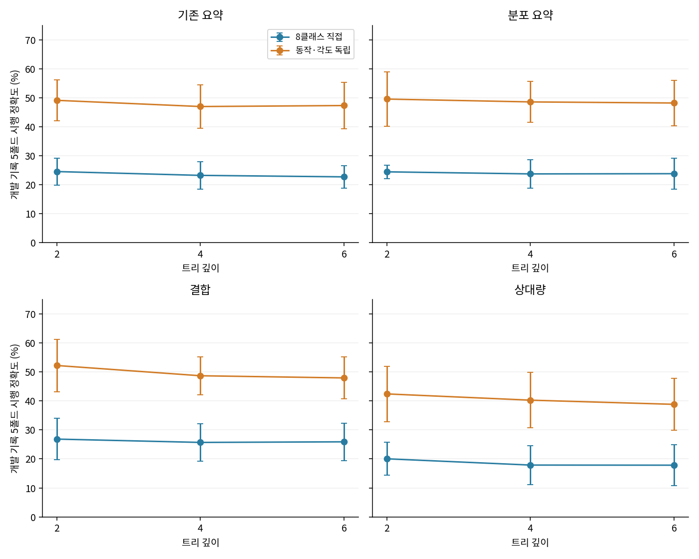
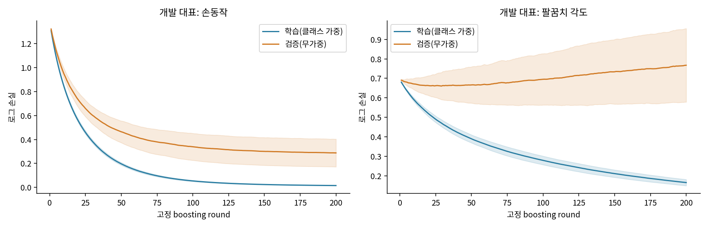
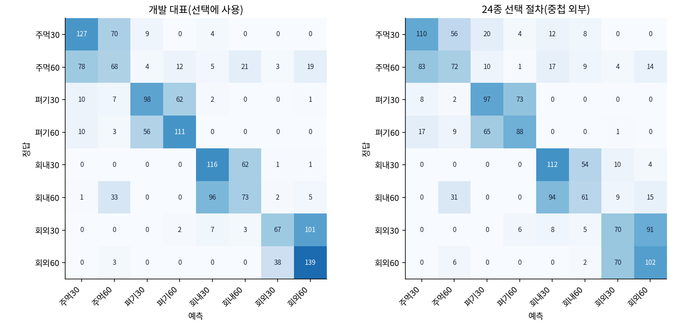
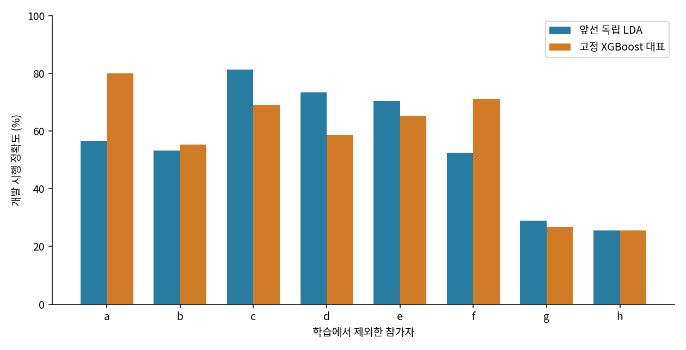

# XGBoost 개발 전용 비교

전체 과제와 누적 비교는 [루트 README](../../README.md#106-xgboost-부스팅과-분류-구조의-추가-대조)에 있다.

## 문제와 가설

앞선 독립 LDA는 개발 54.65%였지만 각도 오류가 많았다. 부스팅의 비선형 경계와 손동작·각도 독립 구조를 결합하면 이 오류가 줄어드는지 확인했다. 기존 1초 특징 4종·구조 2종·깊이 3종을 교차한 24종을 [사전 계획](PROTOCOL.md)으로 고정했다. 기존 A 개발 51기록·1,530시행만 사용했으며 A/B 시험은 다시 열지 않았다.

## 설정과 평가

입력은 기존 요약 140개, 분포 요약 280개, 결합 395개, 상대량 320개다. 각 특징의 정의와 생성 코드는 [앞선 ML 방법](../ml_v3/README.md)에 있다. 독립 구조는 손동작 4클래스와 각도 2클래스를 각각 학습한 뒤 확률을 곱한다. 깊이는 2·4·6, 나머지는 200라운드·eta 0.05·min_child_weight 5·lambda 5·subsample/colsample 각 0.8·max_bin 128·seed 20261024로 고정했다. 학습 헤드별 클래스 가중치는 학습 빈도에서만 계산했다.

같은 기록 5폴드의 macro-F1 평균으로 개발 대표를 선택했다. 별도로 외부 5폴드 각각에서 내부 3폴드로 24종을 선택하고 모든 선택을 잠근 뒤 외부를 평가했다. 대표를 고정한 다음 두 기록 재분할과 참가자 8명 제외 진단을 수행했다. 이전 개발 결과로 후보를 설계한 이력은 남으며, 중첩 점수도 독립 신규 자료의 시험을 대신하지 않는다.

## 주요 결과

- 개발 대표 `fusion_independent_d2`: 시행 정확도 52.24±9.03%, macro-F1 0.5050, 손동작 89.10%, 각도 60.62%.
- 24종 중첩 선택 절차: 시행 정확도 46.70±8.40%, macro-F1 0.4458.
- 외부 폴드 선택: relative_independent_d2, robust_independent_d2, robust_independent_d4, legacy_independent_d2, legacy_independent_d2.
- 앞선 독립 LDA 개발 54.65%, F1 0.5138보다 낮아 기존 개발 대표를 교체하지 않았다. 앞선 23종 중첩 40.52%는 다른 후보군의 선택 절차다.

*그림 1. 개발 기록 5폴드의 정확도 평균±표준편차. 특징, 구조와 깊이를 교차한 전체 24종이다.*

*그림 2. 대표의 고정 200라운드 로그 손실 평균±표준편차. 학습에는 클래스 가중치, 검증에는 무가중 손실을 사용했다. 곡선으로 라운드를 다시 선택하지 않았다.*

*그림 3. 개발 선택용 대표와 중첩 외부 예측의 혼동행렬. 각각 1,530시행이며 숫자는 건수, 색은 정답별 비율이다.*

개발 대표의 오류 731건 중 563건, 중첩 오류 818건 중 586건이 같은 손동작의 반대 각도였다. 비선형 모델에서도 각도 정보의 기록 간 변화가 주요 문제로 남았다. 이 관찰만으로 전극 위치나 생리적 원인을 확정할 수는 없다.

## 고정 대표의 분할 진단

| 고정 모델 | 기록 분할 1 | 기록 분할 2 | 참가자 제외 평균±SD |
|---|---:|---:|---:|
| 앞선 독립 LDA | 49.53% | 53.41% | 55.25±20.09% |
| XGBoost 개발 대표 | 51.33% | 48.42% | 56.48±20.21% |

*그림 4. 참가자별 개발 기록을 학습에서 제외한 정확도. 같은 개발 자료로 후보를 설계·선택한 뒤 수행한 민감도 진단이며, 결과로 대표를 변경하지 않았다. 참가자별 기록 수와 클래스 구성이 다르다.*

## 전체 후보 결과

| 후보 | 정확도 평균±SD (%) | macro-F1 | 동작 (%) | 각도 (%) | 학습 (%) | 5회 학습 (초) |
|---|---:|---:|---:|---:|---:|---:|
| legacy_joint_d2 | 24.52±4.67 | 0.2202 | 80.12 | 35.03 | 99.59 | 4.43 |
| legacy_joint_d4 | 23.21±4.72 | 0.2054 | 81.48 | 33.71 | 100.00 | 6.98 |
| legacy_joint_d6 | 22.70±3.88 | 0.2012 | 81.55 | 33.21 | 100.00 | 7.78 |
| legacy_independent_d2 | 49.10±7.12 | 0.4660 | 84.05 | 60.50 | 96.60 | 3.82 |
| legacy_independent_d4 | 46.96±7.42 | 0.4498 | 84.22 | 57.39 | 99.97 | 5.82 |
| legacy_independent_d6 | 47.30±7.94 | 0.4523 | 84.56 | 57.61 | 100.00 | 7.03 |
| robust_joint_d2 | 24.43±2.29 | 0.2171 | 82.07 | 34.27 | 99.77 | 5.05 |
| robust_joint_d4 | 23.72±4.84 | 0.2112 | 82.67 | 33.56 | 100.00 | 8.27 |
| robust_joint_d6 | 23.79±5.42 | 0.2154 | 82.34 | 34.08 | 100.00 | 9.34 |
| robust_independent_d2 | 49.54±9.43 | 0.4673 | 85.31 | 60.12 | 97.22 | 4.33 |
| robust_independent_d4 | 48.56±7.03 | 0.4627 | 84.73 | 58.53 | 100.00 | 6.94 |
| robust_independent_d6 | 48.18±7.89 | 0.4605 | 85.07 | 57.55 | 100.00 | 8.38 |
| fusion_joint_d2 | 26.84±7.14 | 0.2567 | 88.37 | 33.49 | 99.89 | 5.72 |
| fusion_joint_d4 | 25.70±6.40 | 0.2466 | 88.36 | 32.14 | 100.00 | 9.13 |
| fusion_joint_d6 | 25.90±6.49 | 0.2497 | 88.25 | 32.53 | 100.00 | 9.91 |
| fusion_independent_d2 | 52.24±9.03 | 0.5050 | 89.10 | 60.62 | 98.37 | 4.87 |
| fusion_independent_d4 | 48.70±6.51 | 0.4707 | 89.10 | 56.15 | 100.00 | 7.49 |
| fusion_independent_d6 | 47.95±7.20 | 0.4646 | 89.16 | 55.01 | 100.00 | 9.03 |
| relative_joint_d2 | 20.04±5.72 | 0.1830 | 87.91 | 27.61 | 99.93 | 5.39 |
| relative_joint_d4 | 17.88±6.70 | 0.1684 | 88.11 | 24.97 | 100.00 | 8.61 |
| relative_joint_d6 | 17.84±7.07 | 0.1678 | 87.84 | 25.25 | 100.00 | 9.49 |
| relative_independent_d2 | 42.44±9.53 | 0.4065 | 88.59 | 48.08 | 98.06 | 4.49 |
| relative_independent_d4 | 40.28±9.59 | 0.3852 | 89.09 | 45.99 | 100.00 | 7.13 |
| relative_independent_d6 | 38.84±8.96 | 0.3718 | 89.16 | 44.50 | 100.00 | 8.63 |

정확도·F1은 같은 5폴드 평균이고 SD는 폴드 간 표준편차다. [후보별 과정](EXPERIMENT_LOG.md)에 비교 기준, 바꾼 조건, 가설, 실패와 선택 이유가 있다. [원 집계 JSON](artifacts/reports/all_comparisons.json)에는 정밀 수치와 폴드별 결과를 보존했다.

## 비용·실패·재현

TITAN Xp에서 504회 최상위 fit을 순차 실행했다. 합산 fit은 10.44분, 표본 측정 최고 온도 80°C였다. 독립 후보는 내부에서 두 모델을 학습하므로 하위 모델 수와 fit 횟수는 다르다. 실제 데이터 실패는 0회다. 합성 복원 검사에서 CPU/GPU 확률 차이 1.19×10⁻⁷을 확인했고 CUDA 장치를 명시해 일치를 확인했다. 원래 실패를 [검사 기록](artifacts/reports/self_check_failure_resolved.json)에 보존했다.

별도 venv의 XGBoost 3.0.5·NCCL 2.32.3 외에 기존 base 554개 패키지는 변경하지 않았다. [환경·wheel 해시](artifacts/reports/environment.json), [503회 점수 재계산·외부 모델 5개 복원 검사](artifacts/reports/verification.json), [자원 기록](artifacts/reports/resources.json)을 제공한다. GPU 전후 표본은 연속 최대값이 아니며, fit 시간은 고정 검증 손실 계산을 포함하고 특징 추출·저장은 제외한다.

재현은 [루트 14.5절](../../README.md#145-xgboost-개발-비교)을 따른다. `run_experiment.py`는 학습·선택, `verify.py`는 저장 결과 검증, `report.py`는 집계·그림 생성을 담당한다. 입력·코드·계획 해시는 [고정 설정](artifacts/results/CONFIG_FROZEN.json)에, 선택은 [선택 잠금](artifacts/results/SELECTION_LOCK.json)에 있다. 원신호·특징 행렬·학습 모델·강의 원본은 공개하지 않는다.

## 판단과 다음 단계

XGBoost에서는 깊이가 얕은 독립 구조가 개발 대표로 선택됐다. 복잡도를 키운 후보와 상대량 특징도 함께 비교했지만 기존 독립 LDA를 넘지 못했다. 부스팅의 추가 성능만으로 논문 수준이나 신규 기록의 90%대 정확도를 확인하지 못했다. B 97.14%와 C 96.20%는 동일 기록 안의 별도 조건으로 유지한다. 추가 트리 튜닝보다 논문 상세 조건과 독립 세션의 각도·전극·동작 시점 정보를 확보해 실패 원인을 구분하는 것이 다음 과제다.

## 각도 학습량 후속 대조

고정 24종 완료 뒤 각도 검증 손실 상승을 보고 학습량만 바꾼 16종을 추가했다. 개발 대표는 손동작 200·각도 100라운드로, 52.88±6.99%, F1 0.5087이었다. 기존 XGBoost보다 0.64%p 높지만 독립 LDA보다 낮았다. 이 값은 개발 전용 추가 선택이며 위의 중첩 46.70%를 이 후보의 점수로 대응시키지 않는다. [계획](ANGLE_ROUNDS_PLAN.md)과 [전체 후속 결과·그림·검사](ANGLE_ROUNDS_RESULTS.md), [루트 본문](../../README.md#107-각도-학습량만-줄인-후속-대조)을 참고한다.
